# CAN-001: DOM structure and field rules

| Field | Value |
|---|---|
| Owner | Miguel Garrido |
| Created | 2026-10-28 |
| Applies to | `SDM.AssetManagement.Common`, `SDM.FacilityManagement.Common`, `SDM.PlanAndBuild.Common`, `SDM.InfraOpsProperties.Common` and their test projects |
| Supersedes | — |
| Related | [ADR-0001](../adr/0001-infraops-package-boundaries-and-composition.md), [TRK-001](../tracks/TRK-001-sdm-unit-test-dom-mock-fidelity.md), [TRK-002](../tracks/TRK-002-sdm-import-export-bulk-reads.md), [SPC-001](../specs/SPC-001-dom-mock-field-value-type-validation.md), [SPC-002](../specs/SPC-002-sdm-json-serialization-contract.md) |

> **Derived from codebase.** Every GUID, field, type, status and transition below was extracted mechanically from this repository on 2026-10-28: the four `<Module>MockMessageHandler.cs` seeds (section definitions, field descriptors, definition links, behaviours), the four `<Module>DomIds.cs` files (GUIDs, enums, status ids), the 25 `<Entity>DomRepository.g.cs` files (model property per field, reference targets, read/write CLR types) and the `<Entity>DomMapper.g.cs` alias tables. Nothing was read from a live DataMiner system; see [§12](#12-facts-reviewers-must-know) for what that implies. Confidence is [Certain] for every table unless a cell says otherwise.

## Table of contents

1. [Module overview](#1-module-overview)
2. [Cross-module relationship graph](#2-cross-module-relationship-graph)
3. [Asset Manager — `SlcAsset_Management`](#3-asset-manager--slcasset_management)
4. [Facility Manager — `SlcFacility_Management`](#4-facility-manager--slcfacility_management)
5. [Plan & Build — `SlcPlan_And_Build`](#5-plan--build--slcplan_and_build)
6. [InfraOps Properties — `InfraopsProperties`](#6-infraops-properties--infraopsproperties)
7. [State machines](#7-state-machines)
8. [Validation rules](#8-validation-rules)
9. [Enum reference](#9-enum-reference)
10. [Field rules](#10-field-rules)
11. [Adding or changing a DOM field — checklist](#11-adding-or-changing-a-dom-field--checklist)
12. [Facts reviewers must know](#12-facts-reviewers-must-know)
13. [Known deviations](#13-known-deviations-flagged-not-fixed)
14. [Rejected alternatives](#14-rejected-alternatives)
15. [Source files reference](#15-source-files-reference)

## Terms

| Term | Meaning here |
|---|---|
| Module | One DOM module (`ModuleId`), one `*.Common` project, one DomIds file, one seed. |
| Definition | A `DomDefinition`; one `DomInstance` per entity instance. |
| Entity | A `public sealed class X : SdmObjectBase<X>` mapped to one definition. |
| Section-detail | A `ChangeTrackingBase` subtype (for example `AssetLocation`) that owns the fields of exactly one single-occurrence DOM `Section`. |
| Repeating-section element | A `ChangeTrackingBase` subtype (for example `AssetHolder`) that is one entry of a `List<T>` on the entity; each element is one DOM `Section` of the same `SectionDefinition`. |
| Link | `SectionDefinitionLink` from a definition to a section: **mandatory** (default), **optional** (`IsOptional`), **repeatable** (`AllowMultipleSections`). |
| DomIds | `SharedMappers.DomIds.<Module>` — GUID constants for module, definitions, sections, fields, behaviours and DOM enums. |
| Mapper | `<Entity>DomMapper.g.cs` — binds model-side section/field names to DomIds. |
| Repository | `<Entity>DomRepository.g.cs` — `FromInstance` / `ToInstance` plus filter translation. |
| Seed | `<Module>MockMessageHandler.cs` — in-memory definitions used by every test. |
| P&O | People & Organizations SDM (`Person`, `Organization`, `Team`, `Role`). External module; referenced, never defined here. |

## The chain every field goes through

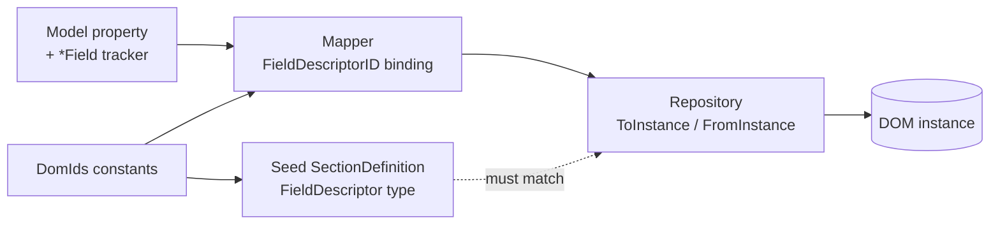

A field exists only when all five places agree: DomIds constant, seed descriptor, mapper binding, repository read **and** write, model property with its tracker. A missing link is a defect, not a partial feature. [§13](#13-known-deviations-flagged-not-fixed) lists the fields where a link is missing today.

---

## 1. Module overview

| Module | `ModuleId` | Project | Definitions | Behaviours | Sections | Field descriptors |
|---|---|---|---|---|---|---|
| Asset Manager | `(slc)asset_management` | `SDM.AssetManagement.Common` | 11 | 2 | 35 | 131 |
| Facility Manager | `(slc)facility_management` | `SDM.FacilityManagement.Common` | 9 | 8 | 20 | 78 |
| Plan & Build | `(slc)plan_and_build` | `SDM.PlanAndBuild.Common` | 3 | 1 | 7 | 35 |
| InfraOps Properties | `(infraops)properties` | `SDM.InfraOpsProperties.Common` | 2 | 0 | 5 | 15 |
| **Total** | | | **25** | **11** | **67** | **259** |

"Field descriptors" counts descriptors per section definition, so a section shared by two definitions (Asset Manager `Holders`, `Attachment`, `CategoryLink`, `DataPortInfo`, `PowerPortInfo`, `Asset`, `PrimaryPortRelation`; Facility Manager `Room`, `Resource`) is counted once.

Field-descriptor CLR types in use across all 259 descriptors:

| DOM type | Count | Used for |
|---|---|---|
| `string` | 150 | free text, string enums (`Enums.X` with `ToValue/ToEnum`), identifiers that are not GUIDs |
| `Guid` | 48 | typed references (`SdmObjectReference<T>`, `PnoObjectReference<T>`) and untyped `ISdmObjectReference` |
| `double` | 29 | dimensions, coordinates, capacities, cable length |
| `DateTime` | 15 | lifecycle, custody, attachment timestamps |
| `long` | 14 | counts, positions, sequences — never `int` |
| `bool` | 10 | flags |
| `int` | 6 | numeric enums only: `Planandbuildjobpromptenum`, `ConnectionType`, `Outputtype` (×2), `Placementorientationenum`, `ThermalType` |
| `TimeSpan` | 2 | `AssetClassLifecycleInformation.NominalLifetime`, `AppSettings.HistoryTTL` |
| `List<Guid>` | 2 | `CableCompatibility.CableTypes`, `JobInformation.Locations` |
| `List<int>` | 2 | `AssetInformation.OperationalFlags`, `TagsInfo.Tags` (numeric enum lists) |
| `List<string>` | 1 | `CategoryLink.Categories` |

Definition size at a glance (fields = sum of descriptors over the definition's linked sections; a repeatable section counts once):

| Module | Definition → fields |
|---|---|
| Asset Manager | Asset **53** · Asset Class **38** · Data Port **13** · Connections **11** · Power Port **9** · History **7** · App Settings **6** · Reservations **5** · Device Type **4** · Port Type **4** · Cable Type **3** |
| Facility Manager | Rack **22** · Zone **12** · Facility **11** · Room **10** · Site **9** · Row **8** · Desk **6** · Floor **5** · App Settings **1** |
| Plan & Build | Job **27** · App Settings **5** · Job Type **3** |
| InfraOps Properties | Property **9** · Property Values **6** |

---

## 2. Cross-module relationship graph

A relationship is a `Guid` (or `List<Guid>`) field whose repository `FromInstance` wraps the value in a reference struct. Three reference kinds exist:

| Reference kind | Target | Resolution | Drawn as |
|---|---|---|---|
| `SdmObjectReference<T>` | another definition in this repo | identifier string → GUID; filterable via rule D7 | solid arrow |
| `PnoObjectReference<T>` | P&O `Person`, `Organization`, `Team`, `Role` | GUID; implicit conversion | solid arrow to **P&O** |
| `ISdmObjectReference<ISdmObject>` / `ISdmObjectReference<IPort>` | untyped; resolved by the caller | identifier string | dotted arrow |

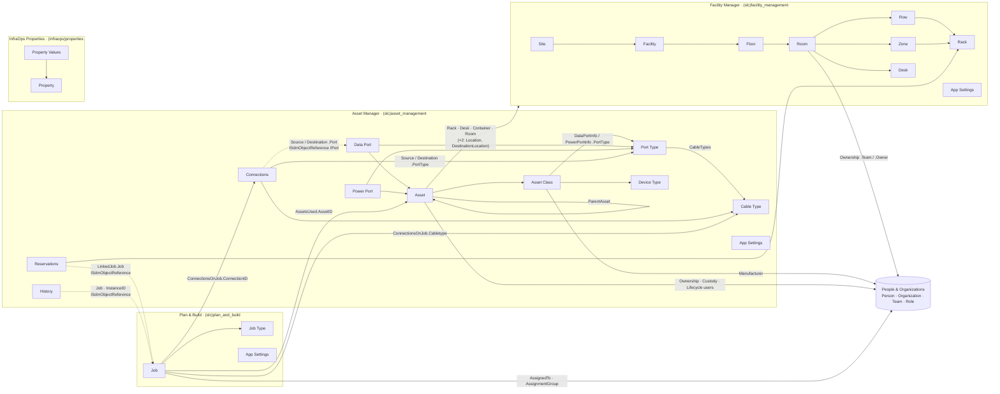

Arrow direction is "holds a reference to". The Facility tree is the only strict hierarchy; `Rack` has two parents (`Row` **and** `Zone`, both mandatory sections). Asset location points at four Facility definitions at once (`Rack`, `Desk`, `Container`→`Facility`, `Room`) and the same four again in `AssetLocationDestination`.

Cross-package dependencies implied by the references: `PlanAndBuild → AssetManagement` (Asset, Connection, Cable Type), `AssetManagement → FacilityManagement` (Rack, Desk, Facility, Room), all three → People & Organizations. `InfraopsProperties` links to any object only through the untyped `PropertyValueInfo.LinkedObjectID` (`string`) + `Scope` pair, never through a typed reference.

`Guid` fields that are **not** wrapped in a reference: `JobInformation.Locations` (`List<Guid>`, kept as plain GUIDs), `Resource.LinkedResource` (DataMiner resource id; see [§13](#13-known-deviations-flagged-not-fixed)), `HistoryInfo.UserID` (mapped, not read or written).

---

## 3. Asset Manager — `SlcAsset_Management`

`ModuleId` `(slc)asset_management` · 11 definitions · 2 behaviours (`Asset_Behavior`, `Asset_Class_Behavior`) · 35 sections · 131 field descriptors.

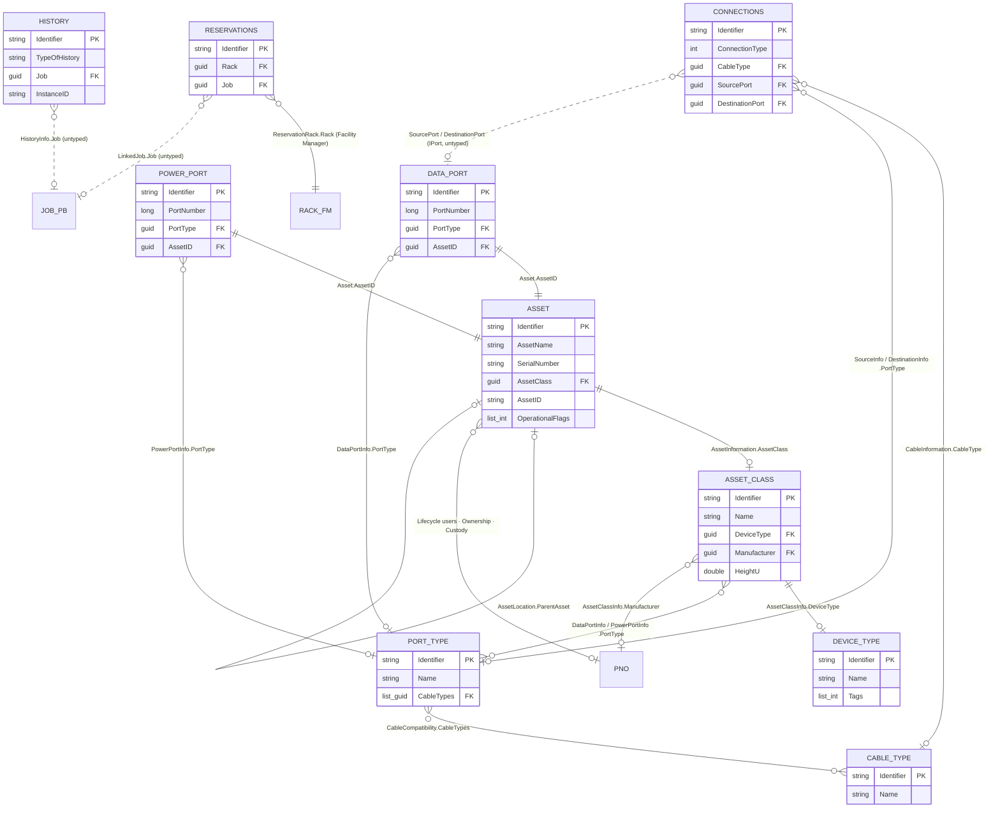

Shared sections inside this module: `Holders` and `Attachment` are linked by both **Asset** and **Asset Class**; `DataPortInfo` / `PowerPortInfo` are the single mandatory section of **Data Port** / **Power Port** *and* a repeatable, optional section of **Asset Class** (the class declares its port template; the port definitions instantiate it). `Asset` and `PrimaryPortRelation` are shared by both port definitions. `CategoryLink` is shared by **Port Type** and **Cable Type**.

Column legend for the tables below: **Link** = `SectionDefinitionLink` flags; **Model property** = path on the entity class (`Holders[]` means one element of the `Holders` list); **Notes** = reference target (`→ X`, `(P&O)` for People & Organizations, `(untyped)` for `ISdmObjectReference`) or a flagged mismatch.

### 3.1 Asset

**Definition ID:** `9035d110-47f3-412d-ac8a-fde31bd4b00f`  
**Model:** `Asset`  
**Behavior:** `Asset_Behavior`  
**Validator:** `AssetValidator`, `AssetValidationHandler`, `AssetValidationCore`, `PlacementValidator`, `RackPlacementValidation`, `AssetTransitionValidator` (`SDM.AssetManagement.Common\Validation\Asset\`)  

**Entity rules:**

- `no-db` At most one of ParentAsset, Rack, Desk, Container, Room may be set in `Location`, and likewise in `DestinationLocation`.
- `no-db` `Location` is editable only when the asset is new or State ∈ {Available, InPlanning, BuildPlanReady, InRepair, Disposed}.
- `no-db` `DestinationLocation` is editable only when State = InTransit, and is mandatory when State = InTransit.
- `no-db` Installation info (InstallationDate + InstallationUserId) is editable only when the asset is new or its original State ∉ {Installed, InService, Disposed}; both must be set before the transition to Installed.
- `db` Linked Data Ports and Power Ports are validated with the Data Port / Power Port rules (§3.6, §3.10).
- State transitions must follow a legal path in `StateMachine` (§7.1), checked by `AssetTransitionValidator`.
- `delete` Allowed only when State ∈ {NotAvailable, Disposed}.

| Section | Section ID | Link | Field | DOM type | Model property | Notes | Rules |
|---|---|---|---|---|---|---|---|
| **AssetInformation** | `58c1a50e-d1c7-4467-8d19-54a29f985d83` | mandatory | AssetName | `string` | `Name` |  | `no-db` Not empty / whitespace `db` Unique across Assets `batch` Unique within the batch |
|  |  |  | SerialNumber | `string` | `SerialNumber` |  | `db` Unique **per Asset Class** `batch` Unique per Asset Class within the batch |
|  |  |  | AssetClass | `Guid` | `AssetClassId` | → AssetClass | `no-db` Required `db` Must exist and be in state Active |
|  |  |  | AssetDescription | `string` | `Description` |  |  |
|  |  |  | FWOS | `string` | `FW_OS` |  |  |
|  |  |  | AssetID | `string` | `AssetID` |  | `no-db` Not empty / whitespace `db` Unique across Assets `batch` Unique within the batch |
|  |  |  | HardwareVersion | `string` | `HardwareVersion` |  |  |
|  |  |  | OperationalFlags | `List<int>` | `OperationalFlags` |  |  |
| **AssetLocation** | `7fd5d383-b925-4d93-ac32-85f7453c8f1d` | mandatory | RackPosition | `long` | `Location.RackPosition` |  | `no-db` Set **iff** Rack is set; must be > 0 `db` Position + Asset Class HeightU must fit within `Capacity.MaximumRackCapacity`; must not overlap another Asset or a Reservation (skipped when HeightU ≤ 0) `batch` Must not overlap another Asset in the batch |
|  |  |  | Side | `string` | `Location.Side` |  | `no-db` Set **iff** Rack is set |
|  |  |  | Rack | `Guid` | `Location.RackId` | → Rack | `db` Rack must exist |
|  |  |  | Desk | `Guid` | `Location.DeskId` | → Desk | `db` Desk must exist |
|  |  |  | Container | `Guid` | `Location.ContainerId` | → Facility | `db` Container (Facility) must exist |
|  |  |  | Room | `Guid` | `Location.RoomId` | → Room | `db` Room must exist |
|  |  |  | PowerSupplyRackPosition | `long` | — | **unused** — mapped, never read/written (§13) |  |
|  |  |  | ParentAsset | `Guid` | `Location.ParentAsset` | → Asset | `db` Parent Asset must exist |
|  |  |  | HolderNumber | `long` | `Location.HolderNumber` |  | `no-db` Set **iff** ParentAsset is set; ≥ 0 `db` Parent's Asset Class Device Type must have a Hierarchy Role; the slot must exist for that role and be free `batch` Two assets in one batch may not claim the same slot |
| **AssetLocationDestination** | `a4b292f2-f634-4e16-b218-783c7a2baa43` | mandatory | RackPosition | `long` | `DestinationLocation.RackPosition` |  | `no-db` Set **iff** Rack is set; must be > 0; Asset Class HeightU must be > 0 to attach to a Rack `db` Position + HeightU must fit within the Rack and not overlap another Asset or Reservation |
|  |  |  | Side | `string` | `DestinationLocation.Side` |  | `no-db` Set **iff** Rack is set |
|  |  |  | Rack | `Guid` | `DestinationLocation.RackId` | → Rack | `db` Rack must exist |
|  |  |  | Desk | `Guid` | `DestinationLocation.DeskId` | → Desk | `db` Desk must exist |
|  |  |  | Container | `Guid` | `DestinationLocation.ContainerId` | → Facility | `db` Container (Facility) must exist |
|  |  |  | Room | `Guid` | `DestinationLocation.RoomId` | → Room | `db` Room must exist |
|  |  |  | PowerSupplyRackPosition | `long` | — | **unused** — mapped, never read/written (§13) |  |
|  |  |  | ParentAsset | `Guid` | `DestinationLocation.ParentAsset` | → Asset | `db` Parent Asset must exist |
|  |  |  | HolderNumber | `long` | `DestinationLocation.HolderNumber` |  | `no-db` Set **iff** ParentAsset is set; ≥ 0 `db` Same parent-slot checks as `Location.HolderNumber` |
| **AssetLifecycle** | `8f8353b9-5189-468f-881a-5841595548e8` | mandatory | PurchaseDate | `DateTime` | `PurchaseDate` |  |  |
|  |  |  | FirstUseDate | `DateTime` | `FirstUseDate` |  |  |
|  |  |  | EndOfWarrantyDate | `DateTime` | `EndOfWarrantyDate` |  |  |
|  |  |  | InstallationDate | `DateTime` | `InstallationDate` |  | `no-db` Set **iff** InstallationUserId is set |
|  |  |  | InstallationUser | `Guid` | `InstallationUserId` | → Person (P&O) | `no-db` Set **iff** InstallationDate is set; required when State ∈ {Installed, InService} |
|  |  |  | ModificationDate | `DateTime` | `ModificationDate` |  | `no-db` Set **iff** ModificationUserId is set |
|  |  |  | ModificationUser | `Guid` | `ModificationUserId` | → Person (P&O) | `no-db` Set **iff** ModificationDate is set |
|  |  |  | EndOfLife | `DateTime` | `EndOfLifeDate` |  |  |
| **AssetOwnership** | `7fc5a856-18a4-46fd-8e34-2bbe4c642982` | mandatory | Organization | `Guid` | `Ownership.Organization` | → Organization (P&O) |  |
|  |  |  | ContactPerson | `Guid` | `Ownership.ContactPerson` | → Person (P&O) | `no-db` Set **iff** ContactPersonRole is set |
|  |  |  | ContactPersonRole | `Guid` | `Ownership.ContactPersonRole` | → Role (P&O) | `no-db` Set **iff** ContactPerson is set |
|  |  |  | Team | `Guid` | `Ownership.Team` | → Team (P&O) |  |
| **AssetCustody** | `db82849f-e6da-478b-b295-dd75de94e0b6` | mandatory | From | `DateTime` | `Custody.From` |  |  |
|  |  |  | Till | `DateTime` | `Custody.Till` |  |  |
|  |  |  | ContactPerson | `Guid` | `Custody.ContactPerson` | → Person (P&O) | `no-db` Set **iff** ContactPersonRole is set |
|  |  |  | Team | `Guid` | `Custody.Team` | → Team (P&O) |  |
|  |  |  | Organization | `Guid` | `Custody.Organization` | → Organization (P&O) |  |
|  |  |  | ContactPersonRole | `Guid` | `Custody.ContactPersonRole` | → Role (P&O) | `no-db` Set **iff** ContactPerson is set |
| **Holders** | `f2048e2c-8d4a-4d18-a808-f2bff352905f` | repeatable | SlotNumber | `long` | `Holders[].SlotNumber` |  | `no-db` Required; ≥ 0; (SlotNumber, HierarchyRole) pair unique |
|  |  |  | HierarchyRole | `string` | `Holders[].HierarchyRole` |  | `no-db` (SlotNumber, HierarchyRole) pair unique |
|  |  |  | Label | `string` | `Holders[].Label` |  |  |
| **ElementLink** | `e711b95b-74ea-4e2a-b08a-4f05cb55a8a5` | repeatable | ElementID | `string` | `ElementLinks[].ElementID` |  | `no-db` Unique within the asset |
|  |  |  | IsPrimary | `bool` | `ElementLinks[].IsPrimary` |  | `no-db` At most one element link is primary |
| **AssetNetworkDetails** | `67d996e7-d63e-4ab3-8f84-b937af51c1be` | mandatory | MACAddress | `string` | `MacAddress` |  |  |
| **Attachment** | `cdfaec69-e775-47f2-bbc0-7ca98d5bbe34` | repeatable | Path | `string` | `Attachments[].FilePath` |  |  |
|  |  |  | AttachedAt | `DateTime` | `Attachments[].AttachedAt` |  |  |
|  |  |  | AttachedBy | `string` | `Attachments[].AttachedBy` |  |  |

### 3.2 Asset Class

**Definition ID:** `d6f9c4c8-9f8d-4e8c-a7e0-1e1500563416`  
**Model:** `AssetClass`  
**Behavior:** `Asset_Class_Behavior`  
**Validator:** `AssetClassValidator`, `AssetClassValidationHandler`, `PortNumberValidator` (`SDM.AssetManagement.Common\Validation\AssetClass\`, `Generic\`)  

**Entity rules:**

- `delete` Allowed only when State ≠ Active and no Asset references the class.

| Section | Section ID | Link | Field | DOM type | Model property | Notes | Rules |
|---|---|---|---|---|---|---|---|
| **AssetClassInfo** | `311b421b-8c62-4fb2-b211-3740a6a17b40` | mandatory | Name | `string` | `Name` |  | `no-db` Not empty / whitespace `db` Unique across Asset Classes `batch` Unique within the batch |
|  |  |  | DeviceType | `Guid` | `DeviceTypeId` | → DeviceType | `no-db` Must be a Guid `db` Device Type must exist |
|  |  |  | Description | `string` | `Description` |  |  |
|  |  |  | Manufacturer | `Guid` | `Manufacturer` | → Organization (P&O) | `no-db` Required `db` Must exist as a P&O Organization |
|  |  |  | Height | `double` | `Height` |  | `no-db` ≥ 0 when set |
|  |  |  | Depth | `double` | `Depth` |  | `no-db` ≥ 0 when set |
|  |  |  | Width | `double` | `Width` |  | `no-db` ≥ 0 when set |
|  |  |  | HeightU | `double` | `HeightU` |  | `no-db` ≥ 0 when set `db` **> 0 and required** when the Device Type has tag `RackUnitConsumer` |
|  |  |  | Weight | `double` | `Weight` |  | `no-db` ≥ 0 when set |
|  |  |  | MaximumPowerConsumption | `double` | `MaximumPowerConsumption` |  | `no-db` ≥ 0 when set |
|  |  |  | TypicalPowerConsumption | `double` | `TypicalPowerConsumption` |  | `no-db` ≥ 0 when set |
|  |  |  | FrontImage | `string` | `FrontImage` |  | `no-db` Must be one of the Attachments |
|  |  |  | BackImage | `string` | `BackImage` |  | `no-db` Must be one of the Attachments |
|  |  |  | PowerSupply | `string` | `PowerSupply` |  | `db` Required when the Device Type has tag `PowerProvider` |
|  |  |  | Citype | `string` | `CIType` |  |  |
|  |  |  | Isbookable | `bool` | `IsBookable` |  |  |
| **AssetClassLifecycleInformation** | `7146ed89-798f-46f9-a534-99ed91d15e29` | mandatory | EOLDate | `DateTime` | `Lifecycle.EndOfLife` |  |  |
|  |  |  | EOSDate | `DateTime` | `Lifecycle.EndOfService` |  |  |
|  |  |  | NominalLifetime | `TimeSpan` | `Lifecycle.NominalLifetime` |  |  |
| **Holders** | `f2048e2c-8d4a-4d18-a808-f2bff352905f` | repeatable | SlotNumber | `long` | `Holders[].SlotNumber` |  | `no-db` ≥ 0; (SlotNumber, HierarchyRole) pair unique |
|  |  |  | HierarchyRole | `string` | `Holders[].HierarchyRole` |  | `no-db` (SlotNumber, HierarchyRole) pair unique |
|  |  |  | Label | `string` | `Holders[].Label` |  |  |
| **DataPortInfo** | `7918fb83-c6de-43c7-82d1-e561aefac746` | repeatable, optional | PortNumber | `long` | `DataPorts[].PortNumber` |  | `no-db` Required; ≥ 0; unique across the class's Data Ports |
|  |  |  | PortName | `string` | `DataPorts[].Name` |  | `no-db` Required |
|  |  |  | PortExposure | `string` | `DataPorts[].PortExposure` |  |  |
|  |  |  | OutputType | `int` | `DataPorts[].OutputType` |  |  |
|  |  |  | PortType | `Guid` | `DataPorts[].PortType` | → PortType | `no-db` Required `db` Port Type must exist |
|  |  |  | Label | `string` | `DataPorts[].Label` |  |  |
| **PowerPortInfo** | `75f703c9-dff8-44ef-9606-49c94a3f2ee4` | repeatable, optional | PortNumber | `long` | `PowerPorts[].PortNumber` |  | `no-db` Required; ≥ 0; unique across the class's Power Ports |
|  |  |  | PortName | `string` | `PowerPorts[].Name` |  | `no-db` Required |
|  |  |  | PortExposure | `string` | `PowerPorts[].PortExposure` |  |  |
|  |  |  | OutputType | `int` | `PowerPorts[].OutputType` |  |  |
|  |  |  | PortType | `Guid` | `PowerPorts[].PortType` | → PortType | `no-db` Required `db` Port Type must exist |
|  |  |  | Label | `string` | `PowerPorts[].Label` |  |  |
| **ProtocolLink** | `6d0fc563-f531-4663-98f7-84a13f47f39a` | mandatory | Protocol | `string` | `ProtocolLink.Protocol` |  |  |
| **Attachment** | `cdfaec69-e775-47f2-bbc0-7ca98d5bbe34` | repeatable | Path | `string` | `Attachments[].FilePath` |  |  |
|  |  |  | AttachedAt | `DateTime` | `Attachments[].AttachedAt` |  |  |
|  |  |  | AttachedBy | `string` | `Attachments[].AttachedBy` |  |  |

### 3.3 Asset Manager App Settings

**Definition ID:** `5372272a-65f3-43e3-9ef4-f7f879de5a26`  
**Model:** `AssetManagerAppSettings`  
**Behavior:** none  

**Entity rules:**

- No field rules (null guard only).

| Section | Section ID | Link | Field | DOM type | Model property | Notes | Rules |
|---|---|---|---|---|---|---|---|
| **AppSettings** | `941488bf-bb5a-46e0-968c-4b96f18fcbf1` | mandatory | EnableAssetHistory | `bool` | `EnableAssetHistory` |  |  |
|  |  |  | PlanAndBuildJobPrompt | `int` | `PlanAndBuildJobPrompt` |  |  |
|  |  |  | EnableConnectionHistory | `bool` | `EnableConnectionHistory` |  |  |
|  |  |  | HistoryTTL | `TimeSpan` | `HistoryTTL` |  |  |
|  |  |  | HistoryLimit | `long` | `HistoryLimit` |  |  |
|  |  |  | EnableResourceLink | `bool` | `EnableResourceLink` |  |  |

### 3.4 Cable Type

**Definition ID:** `b2e24be2-a559-4628-bcfd-e0398644d46a`  
**Model:** `CableType`  
**Behavior:** none  
**Validator:** `CableTypeValidator`, `CableTypeValidationHandler`  

**Entity rules:**

- `delete` Blocked while any Connection uses the cable type or any Port Type lists it as compatible.

| Section | Section ID | Link | Field | DOM type | Model property | Notes | Rules |
|---|---|---|---|---|---|---|---|
| **CableTypeInformation** | `08974346-b8ff-4e00-8cdd-34d401774092` | mandatory | Name | `string` | `Name` |  | `no-db` Not empty / whitespace `db` Unique across Cable Types `batch` Unique within the batch |
|  |  |  | Description | `string` | `Description` |  |  |
| **CategoryLink** | `bda370db-b7e1-431b-991d-37044d0b9176` | mandatory | Categories | `List<string>` | `CategoryLinks.Categories` |  | `no-db` At least one category |

### 3.5 Connections

**Definition ID:** `a7844a51-8221-48da-9a0e-7cfa20262715`  
**Model:** `Connection`  
**Behavior:** none  
**Validator:** `ConnectionValidator`, `ConnectionValidationHandler`, `ConnectionValidationExtensions` (`SDM.AssetManagement.Common\Validation\Connection\`)  

**Entity rules:**

- `no-db` Source and Destination ports must differ.
- `no-db` Both endpoint Assets must exist, have an Asset Class that is Active, and not be in State NotAvailable or Disposed.
- `no-db` Data connection: both endpoint Device Types need tag `AcceptsDataConnection`. Power connection: the source Device Type needs tag `PowerProvider`.
- `db` A port may carry at most `MaxConnectionsPerPort` (= 1) connection.

| Section | Section ID | Link | Field | DOM type | Model property | Notes | Rules |
|---|---|---|---|---|---|---|---|
| **ConnectionInfo** | `a8035b4d-f36e-4093-9002-b80238449b14` | mandatory | Notes | `string` | `Notes` |  |  |
|  |  |  | Description | `string` | `Description` |  |  |
|  |  |  | ConnectionType | `int` | `ConnectionType` |  | `no-db` Required |
| **CableInformation** | `d0b3100f-6a88-4c32-b3fd-4cb7a662c75b` | mandatory | CableLength | `double` | `CableLength` |  | `no-db` ≥ 0 |
|  |  |  | CableType | `Guid` | `CableType` | → CableType; stored as string (§13) | `no-db` Required `db` Cable Type must exist |
| **SourceInfo** | `ea1c78c3-9670-4cf6-8752-29fa9756f275` | mandatory | CableSourceTag | `string` | `Source.CableTag` |  |  |
|  |  |  | SourcePort | `Guid` | `Source.Port` | → IPort (untyped) | `no-db` Required; OutputType ∈ {Out, I/O} `db` Must exist; must be a Data port for Data connections and a Power port for Power connections |
|  |  |  | SourcePortType | `Guid` | `Source.PortType` | → PortType | `no-db` Required `db` Must exist; kind must match ConnectionType; must equal the connected port's own Port Type |
| **DestinationInfo** | `cae60cfd-5a48-4e6b-8f52-e69e8e468a9c` | mandatory | CableDestinationTag | `string` | `Destination.CableTag` |  |  |
|  |  |  | DestinationPort | `Guid` | `Destination.Port` | → IPort (untyped) | `no-db` Required; OutputType ∈ {In, I/O} `db` Must exist; port kind must match ConnectionType |
|  |  |  | DestinationPortType | `Guid` | `Destination.PortType` | → PortType | `no-db` Required `db` Must exist; kind must match ConnectionType; must equal the connected port's own Port Type |

### 3.6 Data Port

**Definition ID:** `280b26f8-7245-4b67-85c1-d42bcf3e9c41`  
**Model:** `DataPort`  
**Behavior:** none  
**Validator:** `DataPortValidator`, `DataPortValidationCore`, `DataPortValidationHandler` (`SDM.AssetManagement.Common\Validation\DataPort\`)  

**Entity rules:**

- `no-db` OutputType cannot change to `In` while the port is a connection source, nor to `Out` while it is a destination.
- `delete` Blocked while connections are assigned to the port.

| Section | Section ID | Link | Field | DOM type | Model property | Notes | Rules |
|---|---|---|---|---|---|---|---|
| **DataPortInfo** | `7918fb83-c6de-43c7-82d1-e561aefac746` | mandatory | PortNumber | `long` | `DataPortInfo.PortNumber` |  | `no-db` Required; ≥ 0 |
|  |  |  | PortName | `string` | `DataPortInfo.Name` |  | `no-db` Required |
|  |  |  | PortExposure | `string` | `DataPortInfo.PortExposure` |  |  |
|  |  |  | OutputType | `int` | `DataPortInfo.OutputType` |  | `no-db` Required |
|  |  |  | PortType | `Guid` | `DataPortInfo.PortType` | → PortType | `db` Required; must exist; must be a **Data** Port Type |
|  |  |  | Label | `string` | `DataPortInfo.Label` |  |  |
| **AddressInfo** | `73f92de5-317d-41dc-b8c3-2563fcb13e50` | optional | IPV4Address | `string` | `AddressInfo.Ipv4Address` |  | `no-db` Valid IPv4 format when set |
|  |  |  | IPV6Address | `string` | `AddressInfo.Ipv6Address` |  | `no-db` Valid IPv6 format when set |
|  |  |  | Hostname | `string` | `AddressInfo.Hostname` |  |  |
|  |  |  | DNS | `bool` | `AddressInfo.DNS` |  |  |
| **Asset** | `45368cbd-a605-4930-8bf2-d0f649edeae0` | mandatory | AssetID | `Guid` | `Asset` | → Asset | `no-db` Required `db` Asset must exist |
| **PrimaryPortRelation** | `2ad90463-9998-4df9-a068-93a13cfa2e6a` | optional | Isprimaryipv4 | `bool` | `PrimaryPortRelation.IsPrimaryIpv4` |  | `no-db` Requires `AddressInfo.Ipv4Address`; at most one primary IPv4 per Asset |
|  |  |  | Isprimaryipv6 | `bool` | `PrimaryPortRelation.IsPrimaryIpv6` |  | `no-db` Requires `AddressInfo.Ipv6Address`; at most one primary IPv6 per Asset |

### 3.7 Device Type

**Definition ID:** `f369e97b-51b2-4cdc-90b4-7a4f86fad82c`  
**Model:** `DeviceType`  
**Behavior:** none  
**Validator:** `DeviceTypeValidator`, `DeviceTypeValidationHandler`  

**Entity rules:**

- `db` Update rejected while any non-Disposed Asset uses the type.
- `delete` Blocked while any Asset Class references the type or any non-Disposed Asset uses it.

| Section | Section ID | Link | Field | DOM type | Model property | Notes | Rules |
|---|---|---|---|---|---|---|---|
| **DeviceTypeInformation** | `516210a2-f739-4462-9df8-2a8146c30bf0` | mandatory | Name | `string` | `Name` |  | `no-db` Not empty / whitespace `db` Unique across Device Types `batch` Unique within the batch |
|  |  |  | Description | `string` | `Description` |  |  |
| **TagsInfo** | `9d0bbc4b-e0be-45e9-8280-6fe36efe12e8` | mandatory | Tags | `List<int>` | `TagsInfo.Tags` |  |  |
| **HierarchyInfo** | `ca44f3ce-2725-49f1-93f2-8eb53d1d858c` | mandatory | HierarchyRole | `string` | `HierarchyInfo.HierarchyRole` |  |  |

### 3.8 History

**Definition ID:** `4d4ad8f7-fe8f-48c4-a373-6d36184de4fb`  
**Model:** `History`  
**Behavior:** none  

**Entity rules:**

- No field rules (null guard only).

| Section | Section ID | Link | Field | DOM type | Model property | Notes | Rules |
|---|---|---|---|---|---|---|---|
| **HistoryInfo** | `cec87feb-30d0-4270-8bf8-7e8282d0513c` | mandatory | Description | `string` | `HistoryInfo.Description` |  |  |
|  |  |  | Job | `Guid` | `HistoryInfo.Job` | → ISdmObject (untyped) |  |
|  |  |  | UserID | `Guid` | — | **unused** — mapped, never read/written (§13) |  |
|  |  |  | InstanceDefinitionID | `string` | `HistoryInfo.ModifiedInstanceDefinitionID` |  |  |
|  |  |  | InstanceID | `string` | `HistoryInfo.ModifiedInstanceID` | → ISdmObject (untyped) |  |
|  |  |  | ExtraInfo | `string` | `HistoryInfo.ExtraInfo` |  |  |
|  |  |  | TypeOfHistory | `string` | `HistoryInfo.TypeOfHistory` | string enum `Typeofhistory` |  |

### 3.9 Port Type

**Definition ID:** `ff930185-a380-46bf-8bfb-8c70f6933c67`  
**Model:** `PortType`  
**Behavior:** none  
**Validator:** `PortTypeValidator` (`SDM.AssetManagement.Common\Validation\PortType\`)  

**Entity rules:**

- `delete` Blocked while any Asset port or Asset Class port uses the Port Type.

| Section | Section ID | Link | Field | DOM type | Model property | Notes | Rules |
|---|---|---|---|---|---|---|---|
| **PortTypeInformation** | `7b019f7b-024c-46ec-814d-5a65b1e5fabe` | mandatory | Name | `string` | `Name` |  |  |
|  |  |  | Description | `string` | `Description` |  |  |
| **CategoryLink** | `bda370db-b7e1-431b-991d-37044d0b9176` | mandatory | Categories | `List<string>` | `CategoryLinks.Categories` |  | `no-db` At least one category |
| **CableCompatibility** | `bccf76f0-1c97-4e8b-8c78-156a18ec4e2c` | mandatory | CableTypes | `List<Guid>` | `CableFKs.CableTypeFks` | → CableType | `no-db` At least one; none empty `db` Each Cable Type must exist |

### 3.10 Power Port

**Definition ID:** `edfd08fd-ecae-44db-949a-8ca5d17ee22d`  
**Model:** `PowerPort`  
**Behavior:** none  
**Validator:** `PowerPortValidator`, `PowerPortValidationCore`, `PowerPortValidationHandler` (`SDM.AssetManagement.Common\Validation\PowerPort\`)  

**Entity rules:**

- `no-db` OutputType cannot change to `In` while the port is a connection source, nor to `Out` while it is a destination.
- `delete` Blocked while connections are assigned to the port.

| Section | Section ID | Link | Field | DOM type | Model property | Notes | Rules |
|---|---|---|---|---|---|---|---|
| **PowerPortInfo** | `75f703c9-dff8-44ef-9606-49c94a3f2ee4` | mandatory | PortNumber | `long` | `PowerPortInfo.PortNumber` |  | `no-db` Required; ≥ 0 |
|  |  |  | PortName | `string` | `PowerPortInfo.Name` |  | `no-db` Required |
|  |  |  | PortExposure | `string` | `PowerPortInfo.PortExposure` |  |  |
|  |  |  | OutputType | `int` | `PowerPortInfo.OutputType` |  | `no-db` Required |
|  |  |  | PortType | `Guid` | `PowerPortInfo.PortType` | → PortType | `db` Required; must exist; must be a **Power** Port Type |
|  |  |  | Label | `string` | `PowerPortInfo.Label` |  |  |
| **Asset** | `45368cbd-a605-4930-8bf2-d0f649edeae0` | mandatory | AssetID | `Guid` | `Asset` | → Asset | `no-db` Required `db` Asset must exist |
| **PrimaryPortRelation** | `2ad90463-9998-4df9-a068-93a13cfa2e6a` | optional | Isprimaryipv4 | `bool` | — | **unused** — mapped, never read/written (§13) |  |
|  |  |  | Isprimaryipv6 | `bool` | — | **unused** — mapped, never read/written (§13) |  |

### 3.11 Reservations

**Definition ID:** `203aacf0-ad18-4d52-b243-9547fa8b2553`  
**Model:** `InfraopsReservation`  
**Behavior:** none  
**Validator:** `InfraopsReservationValidator` (`SDM.AssetManagement.Common\Validation\Reservations\`), `RackPlacementValidation` (`Validation\Asset\`)  

**Entity rules:**

- `no-db` At least one reserved position range is required.
- `db` Each reserved range must lie inside the Rack's capacity and must not overlap an installed Asset or another Reservation.

| Section | Section ID | Link | Field | DOM type | Model property | Notes | Rules |
|---|---|---|---|---|---|---|---|
| **ReservationInfo** | `2ad67f52-0826-4234-ba7e-bbf9ef046fad` | mandatory | Description | `string` | `Description` |  |  |
| **ReservationRack** | `5b1c5bb2-ec0e-4f65-a195-58f47eb40d61` | mandatory | Rack | `Guid` | `RackFk.Rack` | → Rack | `no-db` Required `db` Rack must exist |
| **ReservedPositions** | `a22f5492-2021-4eea-8d02-357f778297df` | repeatable | ReservedPositionsLowerBound | `long` | `ReservedPositions[].LowerBound` |  |  |
|  |  |  | ReservedPositionsUpperBound | `long` | `ReservedPositions[].UpperBound` |  |  |
| **LinkedJob** | `affb2069-39ff-4318-868e-f19b298477f1` | optional | Job | `Guid` | `JobFk.Job` | → ISdmObject (untyped) |  |

---

## 4. Facility Manager — `SlcFacility_Management`

`ModuleId` `(slc)facility_management` · 9 definitions · 8 behaviours (one per physical entity, all identical Draft → Active → Deprecated) · 20 sections · 78 field descriptors.

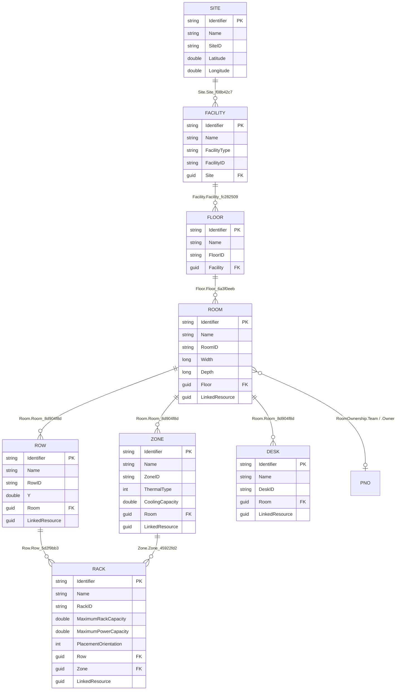

Two sections are shared across definitions: `Room` (`3ee83337-…`) is the parent link of **Row**, **Zone** and **Desk**; `Resource` (`2f8f34af-…`) carries the DataMiner booking-resource id on **Rack**, **Zone**, **Row**, **Desk** and **Room**. The parent-link field names are generator-suffixed (`Site_f08b42c7`, `Facility_fc282509`, `Floor_6a3f0eeb`, `Room_8d904f8d`, `Row_5d2f9bb3`, `Zone_45922fd2`); the mapper aliases them to `<Parent>Fk.<Parent>` (rule D8).

**Rack** is the only definition with two mandatory parent links (`Row` and `Zone`); the repository writes whichever references are set — neither is enforced as present.

### 4.1 Desk

**Definition ID:** `9af0e791-b171-4b92-86e7-79dbb8282f66`  
**Model:** `Desk`  
**Behavior:** `Desk_Behaviour`  
**Validator:** `DeskValidator`, `DeskValidationHandler` (`SDM.FacilityManagement.Common\Validation\`)  

| Section | Section ID | Link | Field | DOM type | Model property | Notes | Rules |
|---|---|---|---|---|---|---|---|
| **DeskInformation** | `20bcc5d1-5065-4091-a5b0-82a09ecb9ddb` | mandatory | Name | `string` | `Name` |  | `no-db` Not empty / whitespace |
|  |  |  | Plan | `string` | `Plan` |  |  |
|  |  |  | Description | `string` | `Description` |  |  |
|  |  |  | DeskID | `string` | `DeskID` |  | `no-db` Not empty / whitespace `db` Unique `batch` Unique within the batch |
| **Room** | `3ee83337-fe05-417e-b328-08a7931da62f` | mandatory | Room_8d904f8d | `Guid` | `RoomFk.Room` | → Room | `no-db` Required `db` Room must exist |
| **Resource** | `2f8f34af-8405-4a7e-b996-da6b9d97e61c` | mandatory | LinkedResource | `Guid` | `Resource.ResourceId` | written/read as `string` (§13) |  |

### 4.2 Facility

**Definition ID:** `dab0442b-b092-4dbf-a249-19dd421c69db`  
**Model:** `Facility`  
**Behavior:** `Facility_Behaviour`  
**Validator:** `FacilityValidator`, `FacilityValidationHandler`  

**Entity rules:**

- `delete` Blocked while Floors reference the facility.

| Section | Section ID | Link | Field | DOM type | Model property | Notes | Rules |
|---|---|---|---|---|---|---|---|
| **FacilityInformation** | `125d4f2c-4d9f-4efe-9af6-1e6a5d4bcaab` | mandatory | Name | `string` | `Name` |  | `no-db` Not empty / whitespace |
|  |  |  | FacilityType | `string` | `FacilityType` |  |  |
|  |  |  | Description | `string` | `Description` |  |  |
|  |  |  | Address | `string` | `Address` |  |  |
|  |  |  | City | `string` | `City` |  |  |
|  |  |  | ZipCode | `string` | `ZipCode` |  |  |
|  |  |  | Country | `string` | `Country` |  |  |
|  |  |  | Latitude | `double` | `Latitude` |  | `no-db` −90 … 90 when set |
|  |  |  | Longitude | `double` | `Longitude` |  | `no-db` −180 … 180 when set |
|  |  |  | FacilityID | `string` | `FacilityId` |  | `no-db` Not empty / whitespace `db` Unique `batch` Unique within the batch |
| **Site** | `9a6552d4-c538-45be-93fd-a879587d25cc` | mandatory | Site_f08b42c7 | `Guid` | `SiteFk.Site` | → Site | `db` Site must exist **when set** (not required) |

### 4.3 Facility Manager App Settings

**Definition ID:** `a07a6f21-b919-4903-ae76-c8442fd97f54`  
**Model:** `FacilityManagerAppSettings`  
**Behavior:** none  

**Entity rules:**

- No field rules (null guard only).

| Section | Section ID | Link | Field | DOM type | Model property | Notes | Rules |
|---|---|---|---|---|---|---|---|
| **AppSettings** | `67ba4303-7c6b-4c2c-bb8b-0fb2fb4d970d` | mandatory | GoogleMapsAPIKey | `string` | `GoogleMapsAPIKey` |  |  |

### 4.4 Floor

**Definition ID:** `9bbb18c2-8284-4e12-a1d1-f2ebb7e2c1fc`  
**Model:** `Floor`  
**Behavior:** `Floor_Behaviour`  
**Validator:** `FloorValidator`, `FloorValidationHandler`  

**Entity rules:**

- `delete` Blocked while Rooms reference the floor.

| Section | Section ID | Link | Field | DOM type | Model property | Notes | Rules |
|---|---|---|---|---|---|---|---|
| **FloorInformation** | `f3b701eb-5ae6-4cb3-8207-b11c7801e136` | mandatory | Name | `string` | `Name` |  | `no-db` Not empty / whitespace |
|  |  |  | Plan | `string` | `Plan` |  |  |
|  |  |  | Description | `string` | `Description` |  |  |
|  |  |  | FloorID | `string` | `FloorId` |  | `no-db` Not empty / whitespace `db` Unique `batch` Unique within the batch |
| **Facility** | `9f0aade4-5dc5-4d88-b350-15bd8fafed28` | mandatory | Facility_fc282509 | `Guid` | `FacilityFk.Facility` | → Facility | `no-db` Required `db` Facility must exist (failure is keyed to `FloorId`, see §13) |

### 4.5 Rack

**Definition ID:** `c7877685-0295-40b2-acb1-9aea5d7d9c21`  
**Model:** `Rack`  
**Behavior:** `Rack_Behaviour`  
**Validator:** `RackValidator`, `RackValidationHandler` (constants `MAX_RACK_HEIGHT_CM` = 320, `MAX_RACK_SIZE_CM` = 120, `MAX_RACK_CAPACITY_U` = 70)  

| Section | Section ID | Link | Field | DOM type | Model property | Notes | Rules |
|---|---|---|---|---|---|---|---|
| **RackInformation** | `05207b85-724c-4b96-8e50-e8419bb32696` | mandatory | Name | `string` | `Name` |  | `no-db` Not empty / whitespace |
|  |  |  | Model | `string` | `Model` |  |  |
|  |  |  | Position | `string` | `Position` |  | `no-db` Required |
|  |  |  | Width | `double` | `Width` |  | `no-db` 0 … 120 cm when set |
|  |  |  | Depth | `double` | `Depth` |  | `no-db` 0 … 120 cm when set |
|  |  |  | Height | `double` | `Height` |  | `no-db` 0 … 320 cm when set |
|  |  |  | Description | `string` | `Description` |  |  |
|  |  |  | Bookable | `bool` | `Bookable` |  |  |
|  |  |  | CoolingFlow | `string` | `CoolingFlow` |  |  |
|  |  |  | X | `double` | `XPosition` |  |  |
|  |  |  | Y | `double` | `YPosition` |  |  |
|  |  |  | Label | `string` | `Label` |  |  |
|  |  |  | Color | `string` | `Color` |  |  |
|  |  |  | PlacementOrientation | `int` | `Orientation` |  |  |
|  |  |  | RackID | `string` | `RackId` |  | `no-db` Not empty / whitespace `db` Unique `batch` Unique within the batch |
| **RackCapacity** | `790bcbea-9659-4340-91ff-46dc8c37b251` | mandatory | MaximumRackCapacity | `double` | `Capacity.MaximumRackCapacity` |  | `no-db` Required; 1 … 70 U |
|  |  |  | MaximumPowerCapacity | `double` | `Capacity.MaximumPowerCapacity` |  | `no-db` ≥ 0 |
| **Row** | `8a81a86b-7372-4c83-bde7-680004bb3eb4` | mandatory | Row_5d2f9bb3 | `Guid` | `RowFk.Row` | → Row | `no-db` Required `db` Row must exist |
| **Zone** | `785e2397-0f0e-4b82-ace6-9e372a208bf6` | mandatory | Zone_45922fd2 | `Guid` | `ZoneFk.Zone` | → Zone | Not validated (see §13) |
| **Resource** | `2f8f34af-8405-4a7e-b996-da6b9d97e61c` | mandatory | LinkedResource | `Guid` | `Resource.ResourceId` | written/read as `string` (§13) |  |
| **ImageInfo** | `67f72a06-cb71-4a21-9973-0ba04e966be9` | repeatable | ImageFilepath | `string` | `ImageDetails[].ImageFilePath` |  | `no-db` No duplicate paths (case-insensitive) |
|  |  |  | UploadTimestamp | `DateTime` | `ImageDetails[].UploadTimestamp` |  |  |

### 4.6 Room

**Definition ID:** `a09ef2ae-78b6-435a-a5b6-f4b91b3ba14f`  
**Model:** `Room`  
**Behavior:** `Room_Behaviour`  
**Validator:** `RoomValidator`, `RoomValidationHandler`  

**Entity rules:**

- `delete` Blocked while Rows, Zones or Desks reference the room.

| Section | Section ID | Link | Field | DOM type | Model property | Notes | Rules |
|---|---|---|---|---|---|---|---|
| **RoomInformation** | `45f3a9f1-93ca-486b-99f2-70c00f8f80ec` | mandatory | Name | `string` | `Name` |  | `no-db` Not empty / whitespace |
|  |  |  | Plan | `string` | `Plan` |  |  |
|  |  |  | Description | `string` | `Description` |  |  |
|  |  |  | Width | `long` | `Width` |  | `no-db` ≥ 0 when set |
|  |  |  | Depth | `long` | `Depth` |  | `no-db` ≥ 0 when set |
|  |  |  | RoomID | `string` | `RoomId` |  | `no-db` Not empty / whitespace `db` Unique `batch` Unique within the batch |
| **RoomOwnership** | `92517859-4d32-471f-93d6-2a41de0d94ce` | mandatory | Team | `Guid` | `Ownership.Team` | → Team (P&O) |  |
|  |  |  | Owner | `Guid` | `Ownership.Owner` | → Person (P&O) |  |
| **Floor** | `cdbc1f3d-70c8-49e3-a3a3-b310d20b4b6e` | mandatory | Floor_6a3f0eeb | `Guid` | `FloorFk.Floor` | → Floor | `no-db` Required `db` Floor must exist |
| **Resource** | `2f8f34af-8405-4a7e-b996-da6b9d97e61c` | mandatory | LinkedResource | `Guid` | `ResourceLink.ResourceId` | written/read as `string` (§13) |  |

### 4.7 Row

**Definition ID:** `29eef06e-ed52-4a26-95da-fd35cc4433df`  
**Model:** `Row`  
**Behavior:** `Row_Behaviour`  
**Validator:** `RowValidator`, `RowValidationHandler`  

**Entity rules:**

- `delete` Blocked while Racks reference the row.

| Section | Section ID | Link | Field | DOM type | Model property | Notes | Rules |
|---|---|---|---|---|---|---|---|
| **RowInformation** | `12edb830-c667-4e93-9f9b-94e6992a3bf6` | mandatory | Name | `string` | `Name` |  | `no-db` Not empty / whitespace |
|  |  |  | RowPlan | `string` | `Plan` |  |  |
|  |  |  | RowDescription | `string` | `Description` |  |  |
|  |  |  | Y | `double` | `YPosition` |  |  |
|  |  |  | Label | `string` | `Label` |  |  |
|  |  |  | RowID | `string` | `RowId` |  | `no-db` Not empty / whitespace `db` Unique `batch` Unique within the batch |
| **Room** | `3ee83337-fe05-417e-b328-08a7931da62f` | mandatory | Room_8d904f8d | `Guid` | `RoomFk.Room` | → Room | `no-db` Required `db` Room must exist |
| **Resource** | `2f8f34af-8405-4a7e-b996-da6b9d97e61c` | mandatory | LinkedResource | `Guid` | `Resource.ResourceId` | written/read as `string` (§13) |  |

### 4.8 Site

**Definition ID:** `5320914d-ffec-486a-9950-b69276b6c13f`  
**Model:** `Site`  
**Behavior:** `Site_Behaviour`  
**Validator:** `SiteValidator`, `SiteValidationHandler`  

**Entity rules:**

- `delete` Blocked while Facilities reference the site.

| Section | Section ID | Link | Field | DOM type | Model property | Notes | Rules |
|---|---|---|---|---|---|---|---|
| **SiteInformation** | `b082f391-0fdd-4eda-b4dc-f246c5e0063f` | mandatory | Name | `string` | `Name` |  | `no-db` Not empty / whitespace |
|  |  |  | Description | `string` | `Description` |  |  |
|  |  |  | Address | `string` | `Address` |  |  |
|  |  |  | City | `string` | `City` |  |  |
|  |  |  | ZipCode | `string` | `ZipCode` |  |  |
|  |  |  | Country | `string` | `Country` |  |  |
|  |  |  | Latitude | `double` | `Latitude` |  | `no-db` −90 … 90 when set |
|  |  |  | Longitude | `double` | `Longitude` |  | `no-db` −180 … 180 when set |
|  |  |  | SiteID | `string` | `SiteId` |  | `no-db` Not empty / whitespace `db` Unique `batch` Unique within the batch |

### 4.9 Zone

**Definition ID:** `4576240b-b3da-4739-89d1-c3c5e79a26d9`  
**Model:** `Zone`  
**Behavior:** `Zone_Behaviour`  
**Validator:** `ZoneValidator`, `ZoneValidationHandler`  

**Entity rules:**

- `delete` Blocked while Racks reference the zone.

| Section | Section ID | Link | Field | DOM type | Model property | Notes | Rules |
|---|---|---|---|---|---|---|---|
| **ZoneInformation** | `8d225b1a-d69c-4efa-86c3-7f45d6ea7e92` | mandatory | Name | `string` | `Name` |  | `no-db` Not empty / whitespace |
|  |  |  | Plan | `string` | `Plan` |  |  |
|  |  |  | Description | `string` | `Description` |  |  |
|  |  |  | ThermalType | `int` | `ThermalType` |  |  |
|  |  |  | X | `double` | `XPosition` |  |  |
|  |  |  | Y | `double` | `YPosition` |  |  |
|  |  |  | Width | `double` | `Width` |  |  |
|  |  |  | Depth | `double` | `Depth` |  |  |
|  |  |  | ZoneID | `string` | `ZoneId` |  | `no-db` Not empty / whitespace `db` Unique `batch` Unique within the batch |
| **ZoneCapacity** | `136914bb-3580-450f-ad38-3bb709ddc68f` | mandatory | CoolingCapacity | `double` | `ZoneCapacity.CoolingCapacity` |  | `no-db` Required ("must be defined"); ≥ 0 |
| **Room** | `3ee83337-fe05-417e-b328-08a7931da62f` | mandatory | Room_8d904f8d | `Guid` | `RoomFk.Room` | → Room | `no-db` Required `db` Room must exist |
| **Resource** | `2f8f34af-8405-4a7e-b996-da6b9d97e61c` | mandatory | LinkedResource | `Guid` | `Resource.ResourceId` | written/read as `string` (§13) |  |

---

## 5. Plan & Build — `SlcPlan_And_Build`

`ModuleId` `(slc)plan_and_build` · 3 definitions · 1 behaviour (`Job_Behavior`) · 7 sections · 35 field descriptors.

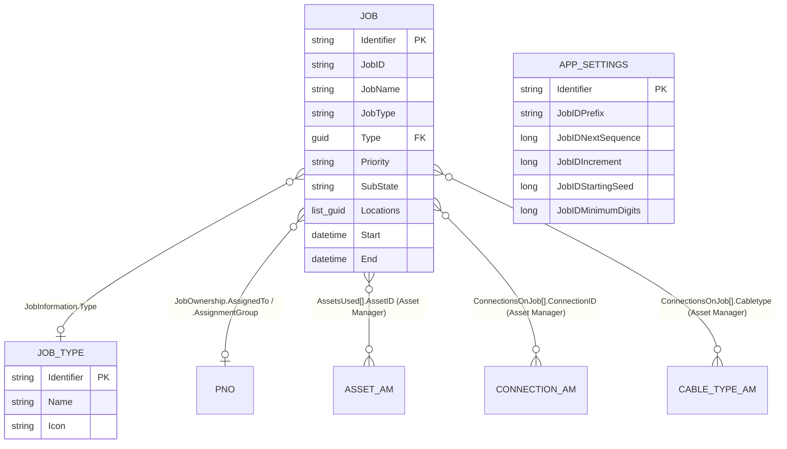

**Job** carries two type notions side by side: `JobInformation.JobType` (`string`, DOM enum `Jobtype` = Add / Update / Remove) and `JobInformation.Type` (`Guid` → **Job Type** definition). Both are mapped and persisted. `JobInformation.Locations` is a plain `List<Guid>`; the repository does not wrap it in references, so the target definition is not asserted anywhere in code. `ConnectionsOnJob[].Cabletype` is declared `string` in DOM yet the repository wraps it in `SdmObjectReference<CableType>` and writes `.Identifier` — the only reference in the repo stored as `string` rather than `Guid` (see [§13](#13-known-deviations-flagged-not-fixed)).

**App Settings** holds the job-id numbering parameters (`JobIDPrefix`, `JobIDNextSequence`, `JobIDIncrement`, `JobIDStartingSeed`, `JobIDMinimumDigits`). How they are combined into a `JobID` is application logic outside this repo. [Likely]

### 5.1 App Settings

**Definition ID:** `529f8806-4f41-44fb-afa7-8df6e40dd509`  
**Model:** `PlanAndBuildAppSettings`  
**Behavior:** none  

**Entity rules:**

- No field rules (null guard only).

| Section | Section ID | Link | Field | DOM type | Model property | Notes | Rules |
|---|---|---|---|---|---|---|---|
| **JobSettings** | `c4c6de12-bbc6-4e61-b818-f7c538369235` | mandatory | JobIDPrefix | `string` | `JobIDPrefix` |  |  |
|  |  |  | JobIDNextSequence | `long` | `JobIDNextSequence` |  |  |
|  |  |  | JobIDIncrement | `long` | `JobIDIncrement` |  |  |
|  |  |  | JobIDStartingSeed | `long` | `JobIDStartingSeed` |  |  |
|  |  |  | JobIDMinimumDigits | `long` | `JobIDMinimumDigits` |  |  |

### 5.2 Job

**Definition ID:** `01bfa461-bdcb-442a-b624-93658d570c9a`  
**Model:** `PlanAndBuildJob`  
**Behavior:** `Job_Behavior`  
**Validator:** `PlanAndBuildJobValidator`, `PlanAndBuildJobValidationHandler`, `PlanAndBuildExternalReferenceChecker` (`SDM.PlanAndBuild.Common\Validation\`)  

**Entity rules:**

- `no-db` Ownership.AssignedTo **and** Ownership.AssignmentGroup are both required when State ∈ {Assigned, Active, Review, Resolved}.

| Section | Section ID | Link | Field | DOM type | Model property | Notes | Rules |
|---|---|---|---|---|---|---|---|
| **JobInformation** | `b28ce9cf-96a1-45bf-8e3d-0f3d1ddc586d` | mandatory | JobID | `string` | `JobID` |  |  |
|  |  |  | JobName | `string` | `JobName` |  | `no-db` Not empty / whitespace; editable only while State = New `db` Unique across Jobs `batch` Unique within the batch |
|  |  |  | Start | `DateTime` | `Start` |  | `no-db` Editable only while State = New |
|  |  |  | JobType | `string` | `JobType` |  |  |
|  |  |  | End | `DateTime` | `End` |  | `no-db` Must be after Start |
|  |  |  | JobDescription | `string` | `JobDescription` |  |  |
|  |  |  | Remarks | `string` | `Remarks` |  |  |
|  |  |  | Priority | `string` | `Priority` |  |  |
|  |  |  | SubState | `string` | `SubState` |  |  |
|  |  |  | Locations | `List<Guid>` | `Locations` |  | `no-db` Editable only while State ∈ {New, Assigned} `db` Each referenced location must exist |
|  |  |  | Type | `Guid` | `Type` | → JobType | `no-db` Required; editable only while State = New `db` Job Type must exist |
| **JobOwnership** | `520a7dac-97ab-42bf-9177-32aeb7b8b9e8` | mandatory | AssignedTo | `Guid` | `Ownership.AssignedTo` | → Person (P&O) | `db` Must exist as a P&O Person when set |
|  |  |  | AssignmentGroup | `Guid` | `Ownership.AssignmentGroup` | → Team (P&O) | `db` Must exist as a P&O Team when set |
| **AssetsUsed** | `c708731e-b09b-4eed-9a96-27fcc0116db6` | repeatable | AssetID | `Guid` | `AssetsUsed[].AssetId` | → Asset | `no-db` Not editable when State ∈ {Resolved, Canceled} `db` Each referenced Asset must exist |
|  |  |  | Action | `string` | `AssetsUsed[].Action` |  |  |
|  |  |  | AssetName | `string` | `AssetsUsed[].AssetName` |  |  |
|  |  |  | AssetClassName | `string` | `AssetsUsed[].AssetClassName` |  |  |
|  |  |  | IPAddress | `string` | `AssetsUsed[].IPAddress` |  |  |
| **JobAttachment** | `ec7a3725-7f71-4373-9e22-e34a1ae82135` | repeatable | FilePath | `string` | `Attachments[].FilePath` |  |  |
|  |  |  | AttachedAt | `DateTime` | `Attachments[].AttachedAt` |  |  |
|  |  |  | AttachedBy | `string` | `Attachments[].AttachedBy` |  | `db` Not empty |
| **ConnectionsOnJob** | `8c165732-abfb-48d6-981e-6f685b7f94ba` | repeatable | Source | `string` | `ConnectionsOnJob[].Source` |  |  |
|  |  |  | Destination | `string` | `ConnectionsOnJob[].Destination` |  |  |
|  |  |  | Status | `string` | `ConnectionsOnJob[].Status` |  |  |
|  |  |  | Cabletype | `string` | `ConnectionsOnJob[].CableType` | → CableType; stored as string (§13) | `db` Each referenced Cable Type must exist |
|  |  |  | CableLength | `double` | `ConnectionsOnJob[].CableLength` |  |  |
|  |  |  | ConnectionID | `Guid` | `ConnectionsOnJob[].ConnectionId` | → Connection | `no-db` Not editable when State ∈ {Resolved, Canceled} `db` Each referenced Connection must exist |

### 5.3 Job Type

**Definition ID:** `447da12d-a9bc-471b-bb90-f33f140851ee`  
**Model:** `JobType`  
**Behavior:** none  
**Validator:** `JobTypeValidator`, `JobTypeValidationHandler`  

**Entity rules:**

- `delete` Blocked while Jobs use the type.

| Section | Section ID | Link | Field | DOM type | Model property | Notes | Rules |
|---|---|---|---|---|---|---|---|
| **JobTypeInfo** | `eba2120c-77d0-43c9-a63a-86abd42be359` | mandatory | Name | `string` | `Name` |  | `no-db` Not empty / whitespace `db` Unique across Job Types; cannot be renamed while Jobs use the type `batch` Unique within the batch |
|  |  |  | Description | `string` | `Description` |  |  |
|  |  |  | Icon | `string` | `Icon` |  |  |

---

## 6. InfraOps Properties — `InfraopsProperties`

`ModuleId` `(infraops)properties` · 2 definitions · 0 behaviours · 5 sections · 15 field descriptors.

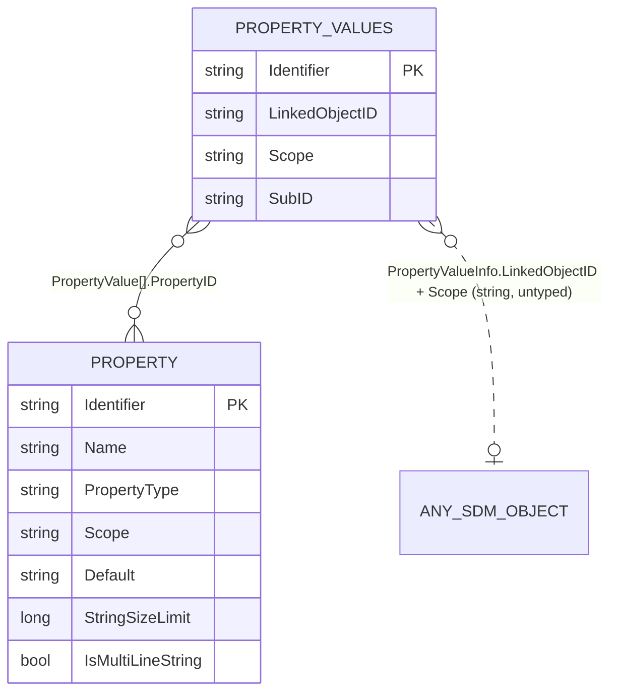

**Property** is the schema (name, `PropertyType` = string / discrete / boolean, `Scope`, default, optional discrete options and layout). **Property Values** is one instance per *(object, scope)* pair holding a repeatable `PropertyValue` section per property. The link to the owning object is a plain `string` identifier plus the `Scope` string; no typed reference exists, so this module has no compile-time dependency on any other SDM package. `Scope` values are the generic `PropertyScope` contract (see the PropertyScope tests in `SDM.InfraOpsProperties.Common.Tests`), not a DOM enum.

### 6.1 Property

**Definition ID:** `d7e4ecb9-dc79-496e-90c7-310b340a248b`  
**Model:** `Property`  
**Behavior:** none  
**Validator:** `PropertyValidator`, `PropertyValidationHandler` (`SDM.InfraOpsProperties.Common\Validation\`)  

| Section | Section ID | Link | Field | DOM type | Model property | Notes | Rules |
|---|---|---|---|---|---|---|---|
| **PropertyInfo** | `a99ddb61-78b5-42c5-939d-521cd6cdc0ef` | mandatory | Name | `string` | `Name` |  | `no-db` Not empty / whitespace `db` Unique **within its Scope** `batch` Unique per Scope within the batch |
|  |  |  | PropertyType | `string` | `PropertyType` |  |  |
|  |  |  | Scope | `string` | `Scope` |  | `no-db` Not empty / whitespace |
|  |  |  | Default | `string` | `Default` |  |  |
|  |  |  | StringSizeLimit | `long` | `StringSizeLimit` |  | `no-db` > 0 when defined |
|  |  |  | IsMultiLineString | `bool` | `IsMultiLineString` |  |  |
| **Discrete** | `3ca75450-2b4b-48df-a893-2ca712f521f7` | repeatable, optional | Option | `string` | `Discreets[].Option` |  | `no-db` Non-empty **iff** PropertyType = Discrete; no duplicates |
| **Layout** | `bd33a4c7-9e7b-44f5-9048-6737ab3191e2` | optional | SectionName | `string` | `Layout.SectionName` |  |  |
|  |  |  | Order | `long` | `Layout.Order` |  |  |

### 6.2 Property Values

**Definition ID:** `239ed807-3508-4f00-b950-6681cc25a332`  
**Model:** `PropertyValues`  
**Behavior:** none  
**Validator:** `PropertyValuesValidator`, `PropertyValuesValidationHandler`  

**Entity rules:**

- `db` (LinkedObjectID, Scope, SubID) must be unique, also within the batch.

| Section | Section ID | Link | Field | DOM type | Model property | Notes | Rules |
|---|---|---|---|---|---|---|---|
| **PropertyValueInfo** | `98c6c75e-855a-438a-b96a-ad14fafe1db7` | mandatory | LinkedObjectID | `string` | `LinkedObjectID` |  | `no-db` Not empty |
|  |  |  | Scope | `string` | `Scope` |  | `no-db` Not empty / whitespace |
|  |  |  | SubID | `string` | `SubID` |  |  |
| **PropertyValue** | `3f0e4530-8569-4eb6-aac3-8e4306b5d3ff` | repeatable, optional | PropertyName | `string` | `Values[].PropertyName` |  | `no-db` Required on every entry; no duplicates within the list `db` Referenced Property must exist |
|  |  |  | Value | `string` | `Values[].Value` |  |  |
|  |  |  | PropertyID | `Guid` | `Values[].PropertyId` | → Property |  |

---

## 7. State machines

A behaviour definition owns the status list, the initial status and the allowed transitions. The model exposes the status as `State` (rule A2); transitions are performed only through the hand-written repository partial (`TransitionTo` / `UpdateAndTransitionTo` / `TransitionAndUpdate`), each guarded by a `State Management\*StateMachine.cs` — Asset alone uses `AssetDomRepositoryExtensions.Transition.cs`. Status and transition ids live in `DomIds.Behaviors.<Behaviour>.Statuses` / `.Transitions`; the seed re-declares them with display names so tests see the same ids as DomIds.

### 7.1 `Asset_Behavior` (Asset)

Behaviour ID `a3301105-8724-4a36-af03-aa196a6d83df` · 9 statuses · 41 transitions · initial **Not Available**.

| Status const | Display name |
|---|---|
| `NotAvailable` | Not Available |
| `Available` | Available |
| `InPlanning` | In Planning |
| `BuildPlanReady` | Build Plan Ready |
| `Installed` | Installed |
| `InService` | In Service |
| `InTransit` | In Transit |
| `InRepair` | In Repair |
| `Disposed` | Disposed |

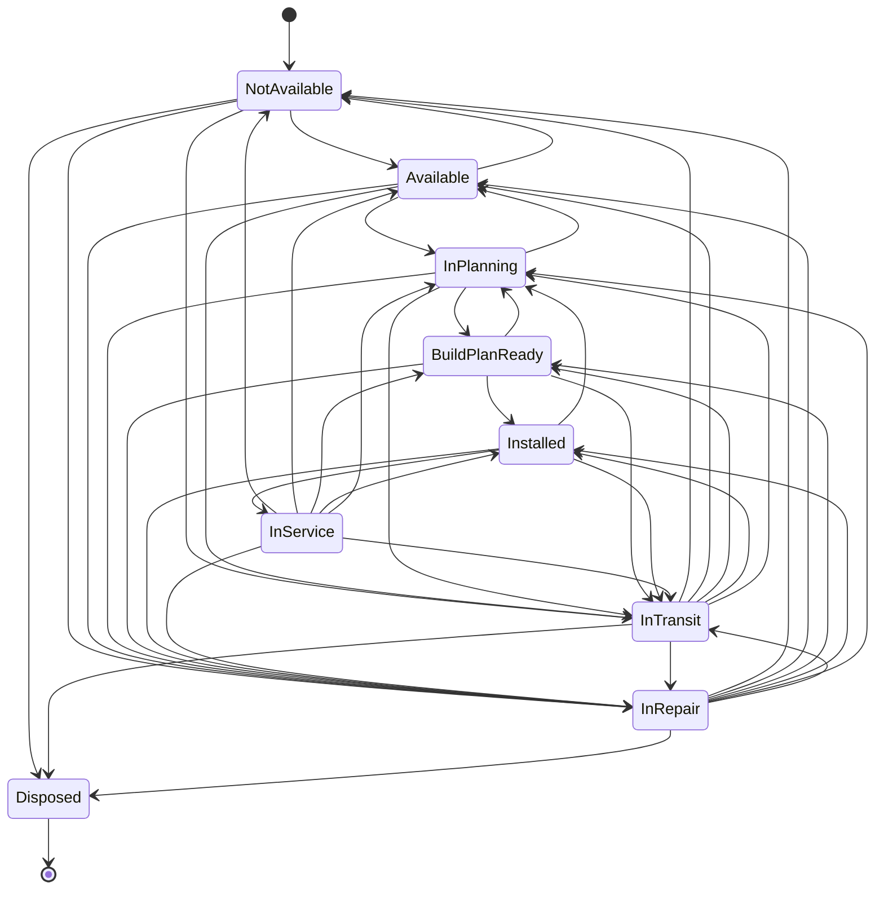

Transition matrix (row = from, column = to; `●` = transition defined):

| from \ to | NotAvailable | Available | InPlanning | BuildPlanReady | Installed | InService | InTransit | InRepair | Disposed | out |
|---|:-:|:-:|:-:|:-:|:-:|:-:|:-:|:-:|:-:|--:|
| **NotAvailable** | | ● | | | | | ● | ● | ● | 4 |
| **Available** | ● | | ● | | | | ● | ● | | 4 |
| **InPlanning** | | ● | | ● | | | ● | ● | | 4 |
| **BuildPlanReady** | | | ● | | ● | | ● | ● | | 4 |
| **Installed** | | | ● | | | ● | ● | ● | | 4 |
| **InService** | ● | ● | ● | ● | ● | | ● | ● | | 7 |
| **InTransit** | ● | ● | ● | ● | ● | | | ● | ● | 7 |
| **InRepair** | ● | ● | ● | ● | ● | | ● | | ● | 7 |
| **Disposed** | | | | | | | | | | 0 |

Reading the matrix:

- The nominal path is `NotAvailable → Available → InPlanning → BuildPlanReady → Installed → InService`; every step forward has a step back except `Installed → BuildPlanReady` (return goes via `InPlanning`).
- `InTransit` and `InRepair` are reachable from every non-terminal status and return to every status except `InService` — an asset coming back from transit or repair must be re-installed first.
- `Disposed` is terminal and reachable only from `NotAvailable`, `InTransit` and `InRepair`. An `Available` or `InService` asset cannot be disposed directly.
- Among the nominal-path statuses, `InService` is the only one that can jump back more than one step (`→ NotAvailable`, `Available`, `BuildPlanReady`, `Installed` directly).
- Repository rule C4 hangs off this machine: `AssetLocationDestination` is written only while `State == InTransit`.

Transition constants are named `<From>_To_<To>` in `DomIds.Behaviors.Asset_Behavior.Transitions`; their values are the lower-case transition ids (`Notavailable_To_Available = "notavailable_to_available"`, `Intransit_To_Inrepair = "intransit_to_inrepair"`).

### 7.2 `Asset_Class_Behavior` (Asset Class)

Behaviour ID `e9e2d567-68f4-4c3f-8154-b3862a1b277b` · 3 statuses · 2 transitions · initial **Draft**.

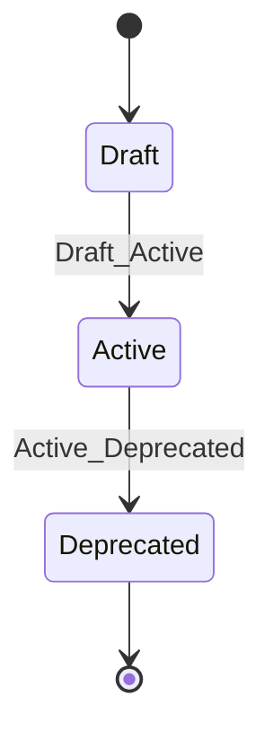

No path back: a deprecated class stays deprecated; a draft cannot be deprecated without passing through `Active`.

### 7.3 Facility Manager behaviours (8 × Draft → Active → Deprecated)

Every physical Facility entity has its own behaviour definition with the same three statuses (`Draft`, `Active`, `Deprecated`), the same two transitions and initial **Draft**. **Facility Manager App Settings** has no behaviour.

| Behaviour | Definition | Behaviour ID |
|---|---|---|
| `Site_Behaviour` | Site | `903a2ba4-5467-4e8e-b728-8f3cd1ff0e72` |
| `Facility_Behaviour` | Facility | `843615ba-3f5d-46a7-91d8-504ddabcdad4` |
| `Floor_Behaviour` | Floor | `558627ea-71eb-4ac6-a655-dedce737649d` |
| `Room_Behaviour` | Room | `cce8f754-26c5-4e5e-97fb-0e474afbec5c` |
| `Row_Behaviour` | Row | `c620b4a2-2139-4f15-ac6f-c8235f669296` |
| `Zone_Behaviour` | Zone | `98f2c20b-c4a6-4297-9d57-291915d298c5` |
| `Rack_Behaviour` | Rack | `4139c312-2b0f-40f3-b875-26cf5066b705` |
| `Desk_Behaviour` | Desk | `fa64f66c-35a8-4b32-8a68-0b0b1341886d` |

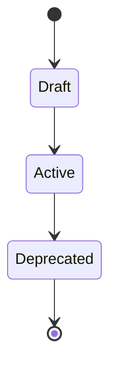

The spelling is `_Behaviour` (British) in Facility Manager and `_Behavior` in Asset Manager and Plan & Build; the constants must be used as generated.

### 7.4 `Job_Behavior` (Job)

Behaviour ID `f66fbbcb-70c8-46ad-acbb-04f8e4b469e9` · 6 statuses · 7 transitions · initial **New**.

| Status const | Display name | Status ID |
|---|---|---|
| `New` | New | `6c75283d-3e15-4377-8459-93ba7764cd35` |
| `Assigned` | Assigned | `2db65456-8365-4da8-b37e-c0f04227549e` |
| `Active` | Active | `fac92634-798d-453e-a76f-d4630e572aaa` |
| `Review` | Review | `0163e48c-a9d0-4bda-9eb8-ce192942605f` |
| `Resolved` | Resolved | `6ddd0ea7-e40a-4844-9d17-5da7cfa9056c` |
| `Canceled` | Canceled | `1fc95659-1f75-4e50-b6e7-7567fc6ff30b` |

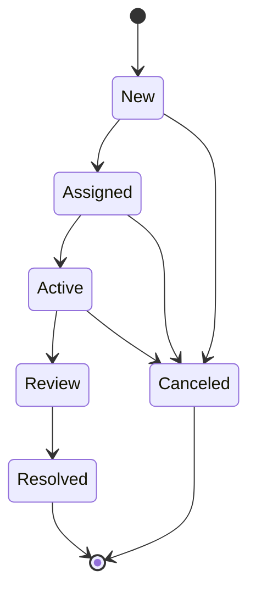

Strictly forward: no transition goes back, `Review` cannot be cancelled, and `Resolved` / `Canceled` are terminal. The 12-value `Substate` string enum on `JobInformation.SubState` is **not** governed by this behaviour — it is a free DOM enum field with no transition rules.

### 7.5 Definitions without a behaviour

Asset Manager: Data Port, Power Port, Connections, History, Reservations, Device Type, Port Type, Cable Type, App Settings. Facility Manager: App Settings. Plan & Build: Job Type, App Settings. InfraOps Properties: both. Their `State` is irrelevant and `DomInstance.StatusId` is never written.

### 7.6 Status-id anomaly in `SlcAsset_ManagementDomIds.cs`

[Certain, in-repo] The status constants of both Asset Manager behaviours are not all GUIDs:

| Behaviour | Const | Value |
|---|---|---|
| `Asset_Behavior` | `NotAvailable` | `2ef172ae-2905-4f4d-ac19-76417e3174cb` |
| | `Available` | `2ef172ae-… (duplicate)` |
| | `BuildPlanReady` | `2ef172ae-… (duplicate) (duplicate) (duplicate)` |
| | `Installed` | `2ef172ae-…` + 4 × ` (duplicate)` |
| | `InService` | `2ef172ae-…` + 5 × ` (duplicate)` |
| | `Disposed` | `2ef172ae-…` + 6 × ` (duplicate)` |
| | `InPlanning` | `59cd7bd7-ea07-43d4-bc64-f27cebe2b194` |
| | `InTransit` | `f4d9841a-20b8-4918-ac48-611a50520601` |
| | `InRepair` | `6278e82d-8681-42c6-b593-92212e15b42f` |
| `Asset_Class_Behavior` | `Draft` | `d749849b-9071-44e4-ba2d-64debdd94758` |
| | `Active` | `d749849b-… (duplicate) (duplicate)` |
| | `Deprecated` | `d749849b-… (duplicate) (duplicate) (duplicate)` |

Facility Manager and Plan & Build status ids are all plain GUIDs. The strings are distinct, so `ToValue/ToEnum` and every test still work, and the seed uses the same constants. Whether the **live** module's `DomStatus.Id` values are these literal strings or real GUIDs cannot be determined from this repository; the DomIds file is generated from the live module, so the suffixes most plausibly originate there. [Guessing] Treat as a reviewed-but-unresolved deviation ([§13](#13-known-deviations-flagged-not-fixed)); do not "fix" the constants in this repo without checking the module.

---

## 8. Validation rules

Every write goes through one `ValidationMiddleware<T>` wired to one `<Entity>Validator : ValidatorBase<T>` (`SDM.InfraOps.Core\Validation\ValidatorBase.cs`). Rules are split by where they can run:

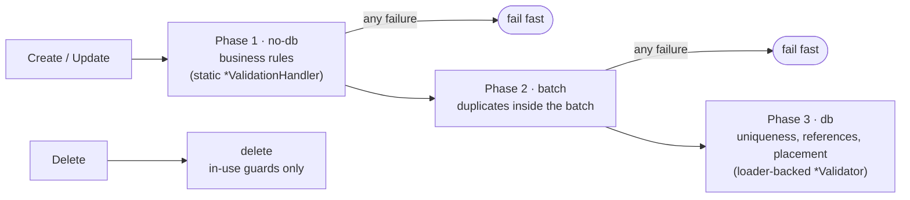

Conventions that hold for every module [Certain]:

| # | Convention | Source |
|---|---|---|
| V1 | `*ValidationHandler` is `static` and pure: it takes the entity (plus any already-loaded context) and never touches a repository. `*Validator` owns the entity loader / API and runs phases 2–3. | all `Validation\` folders |
| V2 | A field rule runs only when `entity.ShouldValidate(<Field>Field)` is true, i.e. `IsNew \|\| field.Changed`. On update, unchanged fields are **not** re-validated; a stored value that violates a newer rule stays valid until touched. | `Core\Validation\ValidationExtensions.cs` |
| V3 | Reference rules run when `ReferenceValidationHelper.ShouldValidateReferences` is true (`IsNew \|\| entity.Changed`). | `Core\Validation\ReferenceValidationHelper.cs` |
| V4 | Failures are recorded as `AddFailReason(<Entity>ValidationField.<Field>, message)`; the field enum is the key the UI binds to. Several results are merged with `AddFailuresFrom` / `MergeFrom`. | `Core\Validation\ValidationResult*.cs` |
| V5 | Numeric bounds use `NumericValidators.ValidateNonNegative / ValidatePositive / ValidateRange` with generated messages (`"The {field} cannot be negative."`, `"The {field} must be between {min} and {max}."`). Optional numerics are skipped when `HasValue` is false. | `Core\Validation\NumericValidator.cs` |
| V6 | FK presence uses `ReferenceValidationHelper.AddRequiredReference` (`"{target} is required."`) and existence `AddMissingReference` (`"Referenced {target} '{id}' does not exist."`). | same |
| V7 | Delete is not validated unless the validator overrides `ValidateBulkForDelete`; those overrides are in-use guards only. | `ValidatorBase.cs` |
| V8 | Status transitions are validated separately by the state machine (§7), not by `*Validator`. Asset additionally runs `AssetTransitionValidator` for multi-hop paths. | `State Management\`, `Validation\Asset\AssetTransitionValidator.cs` |
| V9 | Single-entity "is this id free" helpers (`IsRackIdValid(string)`, `IsAssetClassNameValid(string)` …) exist for real-time UI checks; they issue one query per call and are not used by the bulk path. | `*Validator.cs` |

Constants:

| Constant | Value | Used by |
|---|---|---|
| `MAX_RACK_HEIGHT_CM` | 320 | Rack.Height |
| `MAX_RACK_SIZE_CM` | 120 | Rack.Width, Rack.Depth |
| `MAX_RACK_CAPACITY_U` | 70 | Rack.Capacity.MaximumRackCapacity |
| `MaxConnectionsPerPort` | 1 | Connection endpoints |
| Latitude / Longitude range | −90…90 / −180…180 | Site, Facility |

Where the rules are listed: every definition in §3–§6 carries
- a **Validator** line naming the classes that enforce it,
- a **Rules** column in its field table, one cell per model property, and
- an **Entity rules** list above the table for rules that span several fields or the whole instance (state-gated edits, "at most one location", delete guards).

Each rule is prefixed with the phase in which it runs: `no-db` (static handler), `batch` (duplicates inside one call), `db` (needs a loader), `delete` (in-use guard). A rule is placed on the field it constrains; exceptions are noted in §13. Null-guard failures (`"X cannot be null."`) are omitted, and message text is paraphrased. A field with an empty Rules cell has no validation.

---

## 9. Enum reference

Two encodings exist and are fixed per field (rule D4). **String enums** are a `static class` in `DomIds.Enums` with `const string` values plus `ToValue/ToEnum` and a sibling `<Name>Enum`; the DOM field is `string`. **Numeric enums** are a plain C# `enum` with explicit values; the DOM field is `int` (or `List<int>`).

### 9.1 String enums (DOM type `string`)

| Module | `Enums.` class | Values | Used by field(s) |
|---|---|---|---|
| Asset Manager | `Hierarchyrole` | Chassis, Card, Sub-Card, Module, Fan, Power Supply, None | `Holders.HierarchyRole`, `HierarchyInfo.HierarchyRole` |
| Asset Manager | `Portexposure` | Back, Front | `DataPortInfo.PortExposure`, `PowerPortInfo.PortExposure` |
| Asset Manager | `Typeofhistory` | Add, Modification, Removal | `HistoryInfo.TypeOfHistory` |
| Asset Manager | `Categories` | Networking, Power, Audio, Storage, Peripheral, Video, Misc, Data, Broadcast | `CategoryLink.Categories` (`List<string>`) |
| Asset Manager | `Powersupply` | AC, DC | `AssetClassInfo.PowerSupply` |
| Asset Manager | `Side` | Front, Back, Right, Left | `AssetLocation.Side`, `AssetLocationDestination.Side` |
| Facility Manager | `Facilitytype` | Truck, Container, Building | `FacilityInformation.FacilityType` |
| Facility Manager | `Rackpositionenum` | Bottom, Top | `RackInformation.Position` |
| Facility Manager | `Coolingflowenum` | Front To Rear, Rear To Front, Side To Side, Top To Bottom, Bottom To Top | `RackInformation.CoolingFlow` |
| Plan & Build | `Jobtype` | Add, Update, Remove | `JobInformation.JobType` |
| Plan & Build | `Priority` | Critical, High, Normal, Low | `JobInformation.Priority` |
| Plan & Build | `Substate` | draft, PendingApproval, DocumentationMontage, Reviewed, ResourceAllocation, Scheduled, PendingKickoff, InProgress, UnderReview, OnHold, DocumentationCompleted, Archived | `JobInformation.SubState` |
| Plan & Build | `Actionforassetenum` | Newly Installed, Reinstalled, Provisioned, Commissioned, Removed, Decommissioned, Uninstalled, Dismantled, Modified, Upgraded, Reconfigured, Expanded, Relocated, Patched, Repaired, Serviced, Cleaned, Tested, Audited, Inspected, Tagged, Locked, Unlocked, Connected, Disconnected, Virtualized | `AssetsUsed.Action` |
| InfraOps Properties | `Propertytype` | string, discrete, boolean | `PropertyInfo.PropertyType` |

`Substate.draft` is the only lower-case value in the set; `Categories` is the only string enum stored as a list. Field-to-enum pairing above is taken from the repository `ToValue/ToEnum` calls (`DeviceType` uses local `ToDomHierarchyRole/FromDomHierarchyRole` wrappers around the same enum).

### 9.2 Numeric enums (DOM type `int` / `List<int>`)

| Module | Enum | Values | Used by field(s) |
|---|---|---|---|
| Asset Manager | `Outputtype` | Out = 0, In = 1, IO = 2 | `DataPortInfo.OutputType`, `PowerPortInfo.OutputType` |
| Asset Manager | `ConnectionType` | Data = 0, Power = 1 | `ConnectionInfo.ConnectionType` |
| Asset Manager | `Planandbuildjobpromptenum` | Disabled = 0, Enabled = 1 | `AppSettings.PlanAndBuildJobPrompt` |
| Asset Manager | `Operationalflagsenum` | Faulty = 0 | `AssetInformation.OperationalFlags` (`List<int>`) |
| Asset Manager | `TagOption` | PowerProvider = 0, AcceptsDataConnection = 1, RackUnitConsumer = 2 | `TagsInfo.Tags` (`List<int>`) |
| Facility Manager | `Placementorientationenum` | Vertical = 0, Horizontal = 1 | `RackInformation.PlacementOrientation` |
| Facility Manager | `ThermalType` | None = 0, Warm = 1, Cold = 2 | `ZoneInformation.ThermalType` |

Adding a value to a numeric enum is additive; renumbering or removing one is a data migration. Adding a value to a string enum requires the DOM module to accept it as well — the repo does not validate enum membership on write.

---

## 10. Field rules

Confidence for this whole section: [Certain] unless tagged otherwise. "Enforced by" names the code that makes a violation fail; "convention" means only review catches it.

### A. Identity, status and audit

| # | Rule | Enforced by |
|---|---|---|
| A1 | `Identifier` is the `DomInstance.ID.Id` GUID as a string. `ToInstance` parses it; when empty it mints `Guid.NewGuid()` and the object is treated as new (`IsNew \|\| IsNullOrWhiteSpace(Identifier)`). | repository `ToInstance` |
| A2 | `State` (entity status) is the only model property that maps to `DomInstance.StatusId`, through `Behaviors.<X>_Behavior.Statuses.ToValue/ToEnum`. It is `[SdmIgnore]`, has an `internal` setter and is changed only through the hand-written repository partial (`TransitionTo` / `UpdateAndTransitionTo` / `TransitionAndUpdate`) guarded by the entity's `State Management\*StateMachine.cs`; Asset uses `AssetDomRepositoryExtensions.Transition.cs` instead. | model, `<Entity>DomRepository.cs`, `State Management\` |
| A3 | `CreatedAt`, `CreatedBy`, `LastModified`, `LastModifiedBy` are read from `ITrackBase` on the instance in `FromInstance` and never written. Setters are `internal` on `SdmObjectBase<T>`. | `SdmObjectBase<T>` |
| A4 | Every `*Field` tracker, `IsNew`, `Changed`, `FieldHandler`, section-id holders and other bookkeeping members carry both `[JsonIgnore]` and `[SdmIgnore]`. Only domain data is visible to JSON and to SDM exposers. | convention; checked in review |

### B. One property, one tracker

| # | Rule | Enforced by |
|---|---|---|
| B1 | A public data property never holds state itself. It delegates to an `internal` tracker named `<Property>Field` obtained from `FieldHandler.GetOrCreateField(nameof(Property), () => new ChangeTrackingField<T>(...))`. The key passed is always `nameof(Property)`; it is the name reported in `GetChanges()`. | `ChangeTrackingFieldHandler` throws when a key is reused with another type |
| B2 | `ChangeTrackingField<T>` accepts only value types and `string`. Reference-type data goes through `ChangeTrackingArrayField<T>` (lists) or a nested `ChangeTrackingBase` (section-detail). | `ChangeTrackingField` constructor throws `InvalidOperationException` |
| B3 | Reference-struct fields (`SdmObjectReference<T>`, `PnoObjectReference<T>`, `ISdmObjectReference<T>`) pass `reference => reference.Identifier` as the change converter so diffs compare identifiers, not structs. | convention |
| B4 | Scalars that are optional in DOM are nullable on the model (`long?`, `double?`, `DateTime?`, `Enum?`) and are written only when set. Non-nullable scalars (for example `AssetHolder.SlotNumber`, `RackCapacity.MaximumRackCapacity`) are always written whenever their section is written; choose non-nullable only when `0`/`false` is a legitimate stored value. | convention |
| B5 | List properties never return `null`: getter lazily assigns an empty list, setter coalesces `null` to an empty list. Tracker is `ChangeTrackingArrayField<T>` via `GetOrCreateArrayField`. | model pattern |
| B6 | Section-detail properties are get-only and lazily constructed (`Location => _location ?? (_location = new AssetLocation())`). The entity's `Changed`, `GetChanges()` and `ResetChangeTracking()` must include every section-detail and every list. | model pattern |

### C. Sections

| # | Rule | Enforced by |
|---|---|---|
| C1 | Each section-detail type and each repeating-section element type implements `ISectionTrackable` **explicitly** (`Guid? ISectionTrackable.SectionId`), marked `[JsonIgnore][SdmIgnore]`. `FromInstance` stores the DOM `SectionID` there; `ToInstance` reuses it. Entity-level inline sections keep an `internal Guid? <Section>SectionId` for the same purpose. Reason: a fresh random `SectionID` per save trips DOM's read-only-field check (`ReadOnlyFieldsChangedForCurrentStatus`). | `ISectionTrackable` remarks; repository |
| C2 | Each section-detail type implements `ISectionEmptyState.IsEmpty`, true only when **every** property is at its default. `ToInstance` writes an optional section only when `!IsEmpty`, and omits it otherwise. Never gate on a single field. | `ISectionEmptyState` remarks; repository |
| C3 | Mandatory inline sections (for example Asset `AssetProperties`, `NetworkDetails`, `Lifecycle`) are always added to the instance, even when no field is set. | repository |
| C4 | A section may additionally be status-gated (Asset `DestinationLocation` is written only when `State == InTransit`). Such gates live in `ToInstance`, not in the model. | repository |
| C5 | Repeating sections: `ToInstance` emits one `Section` per list item; `FromInstance` rebuilds the list from `instance.Sections.Where(sameDefinition)` and assigns it wholesale. Each element gets its `SectionId` set. | repository |
| C6 | Every section definition and field descriptor GUID comes from DomIds. Mappers re-wrap `SectionDefinitionID` with `ModuleId` set; field ids are used as-is. No literal GUIDs outside `*DomIds.cs`. | mapper pattern |
| C7 | A section definition may be linked by more than one definition (§3, §4 list them). Its descriptor types are therefore shared: changing a field type on a shared section changes it for every definition that links it. | DOM |

### D. Field value types

The DOM-side type is the `FieldDescriptor` type in the seed, which mirrors the live module. The write side (`AddOrUpdateValue<T>` / `AddOrUpdateListValue<T>`) and read side (`GetValue<T>` / `GetListValue<T>`) must use **exactly** that `T`.

| Model type | DOM descriptor type | Write expression | Read expression |
|---|---|---|---|
| `string` | `string` | `Convert.ToString(x)`, gated `!= default` | `.Value` |
| `long?` / `long` | `long` | `(long)x.Value` | `.Value` |
| `double?` | `double` | `(double)x.Value` | `.Value` |
| `bool` / `bool?` | `bool` | `x` | `.Value` |
| `DateTime?` | `DateTime` | `(DateTime)x` | `(DateTime)v.Value` |
| `TimeSpan?` | `TimeSpan` | `x.Value` | `.Value` |
| `SdmObjectReference<T>` | `Guid` | `x.GetIdentifierAsGuid()`, gated `x.HasValue()` | `new SdmObjectReference<T>(Convert.ToString(guid))` |
| `PnoObjectReference<T>` | `Guid` | implicit/explicit `Guid`, gated `x.HasValue()` | `new PnoObjectReference<T>(guid)` |
| DOM string-enum (`Enums.X` with `ToValue/ToEnum`) | `string` | `Enums.X.ToValue(e)` | `Enums.X.ToEnum(s)` |
| Numeric enum (§9.2) | `int` | `(int)e` | `(Enum)v.Value` |
| `List<enum>` | `List<int>` | `AddOrUpdateListValue<int>(..., list.Select(e => (int)e).ToList())`, gated `IsNotNullOrEmpty()` | `GetListValue<int>(...).Values.Select(i => (Enum)i)` |
| `List<SdmObjectReference<T>>` | `List<Guid>` | `list.Where(x => x.HasValue()).Select(x => x.GetIdentifierAsGuid()).ToList()`, gated `IsNotNullOrEmpty()` | `.Values.Select(g => new SdmObjectReference<T>(Convert.ToString(g)))` |
| `List<Guid>` | `List<Guid>` | list | `.Values` |
| `List<string>` | `List<string>` | list | `.Values` |

| # | Rule | Enforced by |
|---|---|---|
| D1 | Integers are `long` in DOM, never `int`. `int` is reserved for numeric enums. | seed; type table |
| D2 | References are stored as `Guid`, never as string. `GetIdentifierAsGuid()` throws on non-GUID or `Guid.Empty`, so a reference must be gated with `HasValue()` before writing. | `SdmObjectReferenceExtensions` |
| D3 | Null handling: a scalar/reference that is unset is **not written** (no field value emitted). On read, a missing field leaves the model default. Never write `Guid.Empty`, empty string or `default(DateTime)` as a placeholder. | repository gates |
| D4 | Enum encoding is fixed per DOM field and follows the DomIds artefact: if DomIds generated a static class with `ToValue/ToEnum`, the field is a string enum; if it generated a plain `enum` with explicit values, the field is `int`. Do not switch encodings for an existing field — it is a data migration. | DomIds |
| D5 | Seed descriptors are the in-repo oracle. A mapper that writes a different CLR type than the seed declares is a bug even if tests pass today (the current mock does not type-check — see TRK-001/SPC-001, Draft). | seed; ITM-001 when delivered |
| D6 | [Likely] `DateTime` kind is not normalised anywhere in this repo; callers are expected to pass UTC. Flag, do not fix silently. | — |
| D7 | Filter translation for a reference field: `Equals`/`NotEquals` against an empty reference becomes `FieldValues.KeyExists(fieldId).Equal(comparer == NotEquals)`; any other value becomes a `DomInstanceField` filter on the GUID. Filtering on "no value" never compares against `Guid.Empty`. | repository `CreateFilter` |
| D8 | Mapper member names follow the **model** (`CableFKs.CableTypeFks`, `RoomFk.Room`), DomIds names follow the **DOM module** (`CableCompatibility.CableTypes`, `Room.Room_8d904f8d`). Aliasing happens only in the mapper; never rename a DomIds constant to match a model. | mapper pattern |

### E. Change tracking semantics every field inherits

| # | Rule |
|---|---|
| E1 | `Changed` for a scalar compares converted values; for strings, `null` and whitespace are equal to each other; for primitives/enums/`Guid` an `IsSet` flip also counts as a change. |
| E2 | `ChangeTrackingArrayField<T>` is changed when count differs, any element implementing `IChangeTracking` is changed, or converted sequences differ. It clones `ChangeTrackingBase` elements on snapshot. |
| E3 | `FromInstance` ends with `obj.ResetChangeTracking()`; a freshly read object reports `Changed == false`. |
| E4 | `ResetChangeTracking()` on the entity must cascade to section-details and to list elements implementing `IChangeTracking`. |

### F. Validation

| # | Rule | Enforced by |
|---|---|---|
| F1 | Every entity with a repository has one `<Entity>Validator : ValidatorBase<T>` wired through `<Entity>ValidationMiddleware`; the repository never saves an instance that did not pass it. Pure rules live in a `static <Entity>ValidationHandler`, loader-backed rules in the `Validator` (§8, V1). | middleware pipeline |
| F2 | Phases are fixed and fail fast: business rules → batch conflicts → database. A rule that needs another instance (uniqueness, FK existence, placement) belongs in the db phase, never in the Handler. | `ValidatorBase.ValidateBulk` |
| F3 | Field rules are **changed-only** on update (`ShouldValidate` = `IsNew \|\| Changed`). Adding a stricter rule does not invalidate stored data until the field is next touched; a one-off migration is a separate work-item. | `ValidationExtensions` |
| F4 | A failure is keyed by a `<Entity>ValidationField` enum member. Adding a validated field means adding the enum member first; messages are free text but the enum is the API the UI binds to. | `*ValidationField.cs` |
| F5 | Numeric bounds go through `NumericValidators`; FK presence/existence through `ReferenceValidationHelper`. Do not hand-roll `< 0` checks or "does not exist" messages. | `SDM.InfraOps.Core\Validation\` |
| F6 | State-gated edits (which fields may change in which status) are Handler rules reading the entity's **original** state, not state-machine transitions. Transition legality stays in `State Management\` (§7). | `Can*` helpers in Handlers |
| F7 | Delete guards are the only rules in `ValidateBulkForDelete`; they check referencing instances (children, connections, ports, jobs) and nothing else. | validator overrides |

---

## 11. Adding or changing a DOM field — checklist

1. Add the `FieldDescriptorID` to `<Module>DomIds.cs` (regenerate from the DOM module; do not hand-type GUIDs).
2. Add the descriptor to the matching `GenerateSectionsDefinitions_<Section>()` in the seed with the DOM type from the table in §10.D. If the section is shared (rule C7), every linking definition gets the field.
3. Bind it in `<Entity>DomMapper.g.cs` under the right section class (alias per D8).
4. Add the property + `<Property>Field` tracker to the model (rules B1–B6); extend `Equals`/`GetHashCode` and, for section-details, `IsEmpty`.
5. Add both the write (`ToInstance`, gated per D3) and the read (`FromInstance`) in `<Entity>DomRepository.g.cs`.
6. If the field is filterable, add the exposer/filter translation in the same repository.
7. If the field has a rule: add the `<Entity>ValidationField` member, the rule in `<Entity>ValidationHandler` (pure) or `<Entity>Validator` (needs other instances), gated by `ShouldValidate` (rules F1–F5), plus a unit test per failure path.
8. Add or extend: a repository round-trip test, a JSON round-trip test (SPC-002) and, if a new section type, an `ISectionTrackable`/`ISectionEmptyState` test.
9. Update the matching table in §3–§6 of this document (field, type, model property, reference target, **Rules** cell and Entity rules if a rule was added) and §9 if an enum changed.

---

## 12. Facts reviewers must know

| Fact | Confidence |
|---|---|
| The `.g.cs` files are checked in and **hand-maintained**: `Skyline.DataMiner.SDM.SourceGenerator` is commented out in `SDM.AssetManagement.Common.csproj` and `[SdmDomMapper]`/`[GenerateExposers]`/`[SdmDomStorage]` are commented out on the types. The "auto-generated" header is historical. Edit them directly; there is no regeneration step. | [Certain] |
| `SlcAsset_ManagementDomIds.cs` and siblings are generated by the Dom Editor automation script from the live module. They are the source of truth for GUIDs and enum encodings. | [Certain] |
| The seed is not validated against the live DOM module by any test. Drift between seed and module is detected only on a real system. Everything in §1–§9 is therefore "what the repo believes the module looks like". | [Certain] |
| Validation rules (§8) are enforced only by the repository pipeline in this codebase. The live DOM module may carry its own field constraints; none are read or mirrored here. | [Certain] |
| The mock does not check field value CLR types (`Utils.DOM` 10.5.2.6). ITM-001 proposes a validating decorator in the test project. | [Certain] |
| Section and field GUIDs are stable identifiers; display labels in the seed (`"Asset Information"`, `"Rack Capacity"`, …) are not used by any code path and may differ from the live module without effect. | [Certain] |

---

## 13. Known deviations (flagged, not fixed)

| Where | Deviation from rule | Action |
|---|---|---|
| `Asset.Id` (`Guid`, `[JsonIgnore][SdmIgnore]`, public setter) | Unused second identity alongside `Identifier` (A1); no reader or writer in the repo. | Candidate work-item: remove. |
| `AssetLocation.PowerSupplyRackPosition`, `AssetLocationDestination.PowerSupplyRackPosition` (`long`) | Seeded and mapped (`AssetDomMapper.Location/DestinationLocation.PowerSupplyRackPosition`) but never read or written by `AssetDomRepository`; no model property. Chain broken at step 4/5. | Decide: add to `AssetLocation` model or drop from mapper. |
| `HistoryInfo.UserID` (`Guid`) | Mapped (`HistoryDomMapper.g.cs`) but never read or written; `History` has no user property. | Decide: wire to `PnoObjectReference<Person>` or drop. |
| **Power Port** → `PrimaryPortRelation` (optional section, 2 × `bool`) | Linked by the definition and bound in `DataPortDomMapper`, but `PowerPortDomMapper`/`PowerPortDomRepository` neither bind nor read it. Data Port handles the same section fully. | Likely intentional (IP primacy is a data-port concern); either drop the link from the Power Port definition in the module or document it as reserved. |
| `Resource.LinkedResource` (`Guid` in seed) | All five repositories (`Desk`, `Rack`, `Row`, `Zone`, `Room`) read and write it as `string` (`AddOrUpdateValue<string>(…, Convert.ToString(ResourceId))`). Violates D5; the untyped mock hides it. Room additionally `Guid.Parse`s on read, gated `!= Guid.Empty`. | Blocked on ITM-001 (type-checking mock) to confirm which side is wrong; then align seed or repositories. |
| `ConnectionsOnJob.Cabletype` (`string` in seed) | Repository wraps it in `SdmObjectReference<CableType>` and writes `.Identifier` as a string. The only reference in the repo stored as `string`; D2/D7 filters on it would not work. | Treat as text until the module field is changed to `Guid` (data migration). |
| `SdmObjectReferenceConverter` JSON read of `null` | Produces a reference with `null` identifier instead of `default` (see SPC-002 rule 3). Not a DOM issue but affects D2 gates after import. | Tracked in SPC-002 review points. |
| `Asset` entity-level section ids (`AssetPropertiesSectionId`, …) | Held as ad hoc `internal Guid?` properties instead of a shared abstraction; section-details use `ISectionTrackable` (C1). Two mechanisms for one concern. | Accept for now; document here. |
| `Asset_Behavior` / `Asset_Class_Behavior` status ids | 8 of 12 status constants are a GUID with ` (duplicate)` suffixes (§7.6). Functionally distinct strings, but not GUIDs. | Verify against the live module before any change. |
| `Rack.Row` and `Rack.Zone` both mandatory | DOM link says mandatory; repository writes each only when its reference `HasValue()`, and `RackValidator` requires only Row (§4.5). A rack with no Zone is accepted by code. | Accept; the module, not the repo, decides whether to enforce. |
| `FloorValidator` missing-Facility failure | "Referenced Facility does not exist" is keyed to `FloorValidationField.FloorId` although a `FacilityId` member exists and is used for the "required" check (`FloorValidator.cs` ~L196). UI binds the message to the wrong input. | Candidate work-item: key it to `FacilityId`. |

---

## 14. Rejected alternatives

- **Rely on the generator header and regenerate.** The generator package is disabled and the checked-in files have diverged (section tracking, empty-state gates, status gates). Regenerating would discard those.
- **Validate types with `validateAgainstDefinition: true` in `Utils.DOM` 10.6.x.** It checks presence, not CLR type (verified for SPC-001).
- **Store references as string in DOM.** The live module declares these fields as `Guid`; changing the encoding is a data migration and breaks `KeyExists`/GUID filters (D7). `ConnectionsOnJob.Cabletype` shows the cost of the exception.
- **One shared behaviour for all Facility entities.** The module ships eight identical behaviours with distinct ids; collapsing them would change `StatusId` on every instance. Keep as generated.
- **Hand-counted inventory.** Counts in §1 and the per-definition tables are produced by a script over the seeds, DomIds, mappers and repositories; re-run it rather than editing numbers by hand.

---

## 15. Source files reference

| Artefact | Asset Manager | Facility Manager | Plan & Build | InfraOps Properties |
|---|---|---|---|---|
| DomIds (GUIDs, enums, statuses) | `SDM.AssetManagement.Common\SlcAsset_ManagementDomIds.cs` | `SDM.FacilityManagement.Common\SlcFacility_ManagementDomIds.cs` | `SDM.PlanAndBuild.Common\SlcPlan_And_BuildDomIds.cs` | `SDM.InfraOpsProperties.Common\InfraopsPropertiesDomIds.cs` |
| Seed (sections, links, behaviours) | `SDM.AssetManagement.Common\Mock\AssetManagementMockMessageHandler.cs` | `SDM.FacilityManagement.Common\Mock\FacilityManagementMockMessageHandler.cs` | `SDM.PlanAndBuild.Common\Mock\PlanAndBuildMockMessageHandler.cs` | `SDM.InfraOpsProperties.Common\Mock\InfraOpsPropertiesMockMessageHandler.cs` |
| Mappers | `SDM.AssetManagement.Common\Mappers\<Entity>DomMapper.g.cs` (11) | `SDM.FacilityManagement.Common\Mappers\<Entity>DomMapper.g.cs` (9) | `SDM.PlanAndBuild.Common\Mappers\<Entity>DomMapper.g.cs` (3) | `SDM.InfraOpsProperties.Common\Mappers\<Entity>DomMapper.g.cs` (2) |
| Repositories | `SDM.AssetManagement.Common\DOM Repositories\<Entity>\<Entity>DomRepository.g.cs` | `SDM.FacilityManagement.Common\DOM Repositories\<Entity>\<Entity>DomRepository.g.cs` | `SDM.PlanAndBuild.Common\DOM Repositories\<Entity>\<Entity>DomRepository.g.cs` | `SDM.InfraOpsProperties.Common\DOM Repositories\<Entity>DomRepository.g.cs` |
| Transition code | `DOM Repositories\Asset\AssetDomRepositoryExtensions.Transition.cs`, `Extensions\AssetExtensions.Transition.cs`, `Validation\Asset\AssetTransitionValidator.cs`; `DOM Repositories\AssetClass\AssetClassDomRepository.cs`; `State Management\StateMachine.cs` | `DOM Repositories\<Entity>\<Entity>DomRepository.cs`; `State Management\<Entity>StateMachine.cs` (8) | `DOM Repositories\PlanAndBuildJob\PlanAndBuildJobDomRepository.cs`; `State Management\StateMachine.cs` | — |
| Models | `SDM.AssetManagement.Common\Models\` | `SDM.FacilityManagement.Common\Models\` | `SDM.PlanAndBuild.Common\Models\` | `SDM.InfraOpsProperties.Common\Models\` |
| Validation (§8) | `SDM.AssetManagement.Common\Validation\<Entity>\*ValidationHandler.cs`, `*Validator.cs`, `*ValidationCore.cs`; `Middleware\<Entity>ValidationMiddleware.cs` | `SDM.FacilityManagement.Common\Validation\<Entity>ValidationHandler.cs`, `<Entity>Validator.cs`, `FacilityReferenceValidationHelper.cs` | `SDM.PlanAndBuild.Common\Validation\PlanAndBuildJob*.cs`, `JobType*.cs` | `SDM.InfraOpsProperties.Common\Validation\Property*.cs` |
| Validation framework shared by all | `SDM.InfraOps.Core\Validation\` — `ValidatorBase<T>`, `ValidationMiddleware<T>`, `NumericValidator.cs`, `ReferenceValidationHelper.cs`, `ValidationExtensions.cs` (`ShouldValidate`) | | | |
| Field primitives shared by all | `SDM.InfraOps.Core` — `ChangeTrackingField<T>`, `ChangeTrackingArrayField<T>`, `ChangeTrackingBase`, `ISectionTrackable`, `ISectionEmptyState`, `SdmObjectBase<T>` | | | |

Exact file names for seeds are given as they exist today; mapper and repository counts match the definition counts in §1. The extraction script that produced §1–§7 and §9 lives outside the repository (session artefact `dom_tables.ps1`); §8 was extracted with a sibling script (`rules.ps1`) and verified by hand against each validator. If this document is regenerated, re-run them rather than editing tables by hand.
