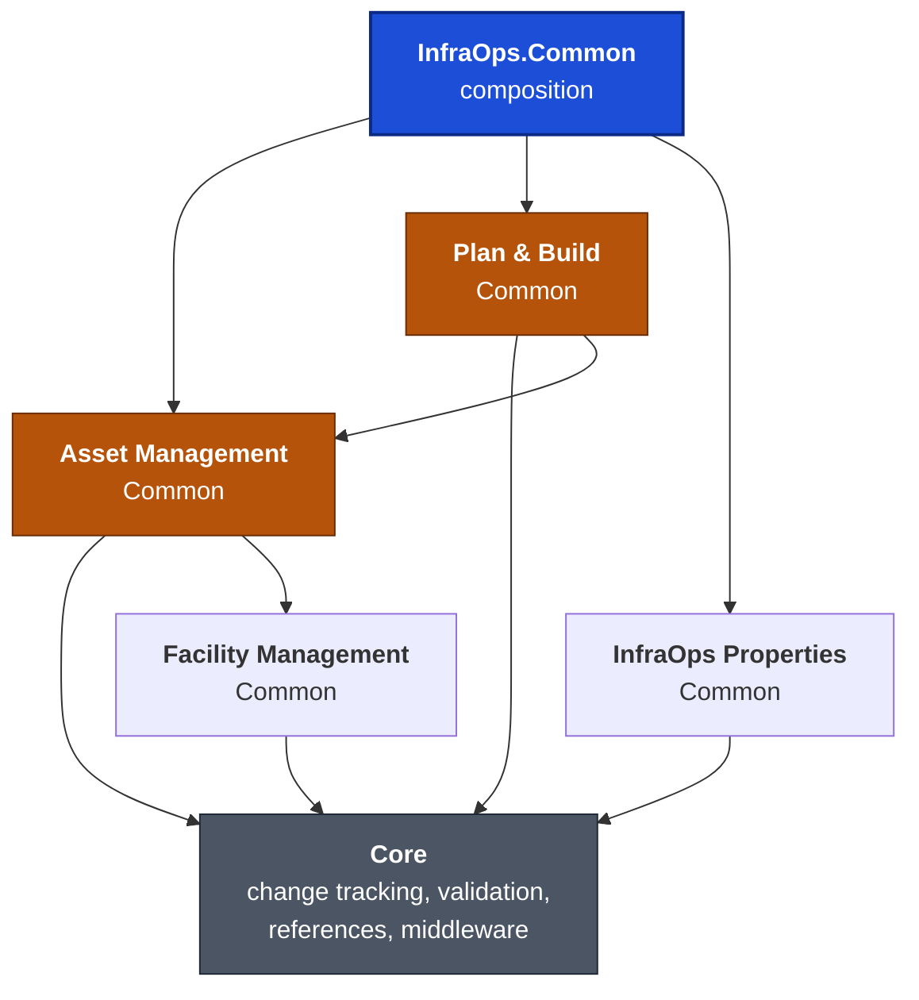
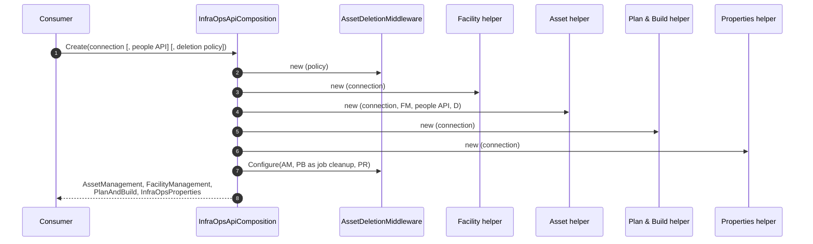

# CAN-002: Package architecture and composition

| Field | Value |
|---|---|
| Owner | Miguel Garrido |
| Created | 2026-11-04 |
| Applies to | Every `SDM.*` project in the solution |
| Supersedes | — |
| Related | [ADR-0001](../adr/0001-infraops-package-boundaries-and-composition.md), [CAN-001](CAN-001-dom-structure.md), [CAN-003](CAN-003-repository-and-middleware-pipeline.md), [CAN-004](CAN-004-change-tracking.md) |

> **Derived from codebase.** Project references, `InternalsVisibleTo` declarations, helper constructors and the composition root were read from source. This document names projects and classes, not file paths. Confidence is [Certain] unless a cell says otherwise.

## Table of contents

1. [Domains and project roles](#1-domains-and-project-roles)
2. [Dependency direction](#2-dependency-direction)
3. [Composition root](#3-composition-root)
4. [Consumer entry points](#4-consumer-entry-points)
5. [Visibility boundaries](#5-visibility-boundaries)
6. [Rules](#6-rules)
7. [Facts reviewers must know](#7-facts-reviewers-must-know)
8. [Rejected alternatives](#8-rejected-alternatives)

## Terms

| Term | Meaning here |
|---|---|
| Domain | One business area with its own DOM module: Asset Management, Facility Management, Plan & Build, InfraOps Properties. |
| Common project | The domain's package: models, DOM repositories, validators, middleware, `*ApiHelper`. Contains no DataMiner-runtime surface. |
| Surface project | A thin project per runtime (Automation, GQI, Protocol) that turns a runtime object into an API helper. |
| Core | The shared library every domain references. Holds the change-tracking, validation, identifier and reference building blocks. |
| API helper | `<Domain>ApiHelper`: the object that owns a domain's wrapped repositories and validators. |
| Composition | `InfraOpsApiComposition`: the one object that builds all helpers of one connection and wires the pieces that span domains. |

---

## 1. Domains and project roles

Every domain follows the same project layout.

| Project role | Purpose | Depends on |
|---|---|---|
| **Common** | Models, repositories, validators, middleware, API helper. The only place domain logic lives. | Core and the domains it builds on (§2) |
| **Automation** | `IEngine` extension that returns the domain's API helper. | Common (and the composition project for Asset Management and Plan & Build) |
| **GQI** | `GQIDMS` and `OnInitInputArgs` extensions that return the helper; GQI-specific projections. | Common (and the composition project for Asset Management and Plan & Build) |
| **Protocol** | `SLProtocol` extension that returns the helper. | Common (and the composition project for Asset Management and Plan & Build) |
| **Tests** | Unit tests against the in-memory DOM mock; see [CAN-001](CAN-001-dom-structure.md). | Common |

Projects that sit outside the domains:

| Project | Role |
|---|---|
| **Core** | Shared building blocks: [change tracking](CAN-004-change-tracking.md), [identifier and validation middleware](CAN-003-repository-and-middleware-pipeline.md), `ValidatorBase`, `ValidationResult`, object references (`ISdmObjectReference`, `PnoObjectReference`), JSON converters, query extensions. Has no project references. |
| **InfraOps.Common (composition)** | The only project that may reference more than one domain. Owns `InfraOpsApiComposition`, `InfraOpsApiHelperFactory` and the Asset deletion cascade. |
| **Common (shared services)** | Cross-domain entity loading used by validators (`SdmEntityLoader`). |
| **Packaging tests** | Verifies NuGet packaging and the property-scope convention. |

All projects target the .NET Framework, because DataMiner runs on it.

## 2. Dependency direction

References point from the domain that needs data toward the domain that owns it. Nothing references upward.

| Domain | May use data from | Why |
|---|---|---|
| Facility Management | — | Owns sites, rooms, racks. Nothing else is needed to describe a place. |
| InfraOps Properties | — | Generic property definitions and values; refer to other domains' objects only by identifier. |
| Asset Management | Facility Management | An Asset sits in a rack, room or desk. |
| Plan & Build | Asset Management (and transitively Facility Management) | A Job lists Assets and Connections. |
| Composition | all of the above | Wires what no single domain may know. |

[Certain] Facility Management and InfraOps Properties never reference Asset Management or Plan & Build. When one of them needs to react to an Asset event, the composition passes the participant in (§3).

## 3. Composition root

`InfraOpsApiComposition.Create(connection)` is the only supported way to obtain Asset Management, Plan & Build, or a consistent set of all four helpers. It exists because the Asset deletion cascade touches three domains, and no domain may reference the others in the reverse direction.

| Step | Rule |
|---|---|
| Overloads | The people API defaults to the one resolved from the connection; the deletion policy defaults to the default policy. Both can be supplied. |
| Order | The deletion middleware is created **first**, because the Asset helper wraps its Asset repository with it. |
| Two-phase wiring | The middleware needs the finished helpers to clean up after a delete, but the Asset helper needs the middleware to be built. `Configure` supplies the participants afterwards. It accepts one call only and throws on a second. |
| Unconfigured use | The middleware throws on any delete if `Configure` was never called. |
| Recovery | The composition exposes `RecoverAssetDeletion` by identifier or by recovery context; both delegate to the same middleware instance. |

The two-phase wiring is known design debt (see [CAN-003](CAN-003-repository-and-middleware-pipeline.md#6-asset-deletion-cascade)). It is contained: no other object is configured after construction.

## 4. Consumer entry points

| Runtime | Entry point | Domains reachable |
|---|---|---|
| Automation script | `engine.Get<Domain>ApiHelper()` | each domain |
| GQI data source | `dms.Get<Domain>ApiHelper()` or `args.Get<Domain>ApiHelper()` | each domain |
| Protocol QAction | `protocol.Get<Domain>ApiHelper()` | each domain |
| Any code holding an `IConnection` | `InfraOpsApiComposition.Create(connection)` | all four |

How each surface builds its helper:

| Domain | Surface extension builds the helper by |
|---|---|
| Asset Management | the factory, which creates a full composition and returns its Asset helper |
| Plan & Build | the factory, same way |
| Facility Management | constructing `FacilityManagementApiHelper` directly |
| InfraOps Properties | constructing `InfraOpsPropertiesApiHelper` directly |

The connection comes from the runtime: the user connection for Automation, the DMS connection for GQI, the raw connection for Protocol.

## 5. Visibility boundaries

Types that other projects must not use are `internal`. Cross-project access is granted explicitly with `InternalsVisibleTo`, never by making a type public for convenience.

| Boundary | What is granted |
|---|---|
| Core to each domain Common and its tests | Core's internal building blocks: change-tracking fields, `ValidationMiddleware<T>`, `IdentifierMiddleware<T>`. They are implementation of the domains, not API for consumers. |
| Asset Management Common to composition, Plan & Build Common, its GQI project and its tests | Internal constructors and helpers the composition needs. |
| Plan & Build Common to composition and its tests | Same. |
| Each Common project to its own tests | White-box test access. |

[Certain] The Asset helper constructor is `internal`. A consumer cannot build an Asset helper without the deletion middleware, so the Asset cascade cannot be forgotten by accident. The Plan & Build helper has a public constructor that works without the cascade; see §7.

## 6. Rules

| # | Rule | Enforced by |
|---|---|---|
| P1 | References point only along the arrows in §2. A domain never references a domain above it. | project references |
| P2 | Only the composition project references more than one domain. | project references |
| P3 | Behaviour that spans domains is a participant passed into the composition, not a new reference between domains. | composition `Configure` pattern |
| P4 | Consumers obtain Asset Management and Plan & Build helpers through the composition or the surface extensions that use it. | internal Asset helper constructor |
| P5 | Surface projects contain no domain logic. They convert a runtime object to a connection and return a helper. | project contents |
| P6 | Core types used by domains are `internal`; the public API of a domain is its helper interface, its models and its repositories' interfaces. | `InternalsVisibleTo` list |

## 7. Facts reviewers must know

| Fact | Confidence |
|---|---|
| Facility Management and InfraOps Properties surfaces construct their helper directly; only Asset Management and Plan & Build go through the composition. A caller who needs the Asset delete cascade, with Plan & Build jobs and Property values cleaned up, must use the composition. | [Certain] |
| `PlanAndBuildApiHelper` has a public constructor taking only a connection. Used that way, it does not take part in the Asset deletion cascade, because the cascade participant is wired by the composition. | [Certain] |
| The two-phase `Configure` call is the only mutable wiring step in the composition. | [Certain] |
| Namespaces do not map one-to-one to projects: the Core project contributes types under `Utils.InfraOps.SharedCommonLibrary` and `Utils.InfraOps.Common`, and the Asset helper has no namespace of its own. Locate types by name, not by namespace. | [Certain] |
| The domain Common packages depend on the `Skyline.DataMiner.SDM` framework, its LINQ extension, `Utils.DOM`, the People & Organizations API, and the performance and secure-coding utilities. | [Certain] |

## 8. Rejected alternatives

- **One package for everything.** Consumers that need only Facility Management would carry Plan & Build and Properties, and every domain release would force every consumer to update.
- **Let Asset Management reference Plan & Build and Properties directly to do the cascade.** Plan & Build already references Asset Management, so this creates a circular reference. [ADR-0001](../adr/0001-infraops-package-boundaries-and-composition.md) records the decision.
- **Events or a service bus between domains.** Adds an asynchronous failure mode and no transaction boundary; the cascade needs a synchronous, reportable outcome per Asset.
- **A static service locator.** Hides which helper a caller depends on and makes unit tests share state.

---
