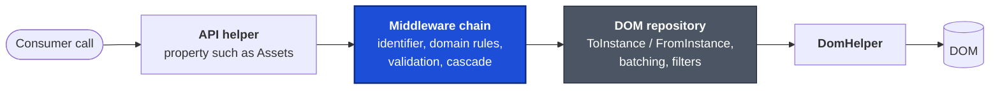
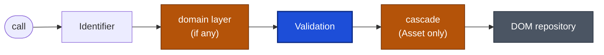
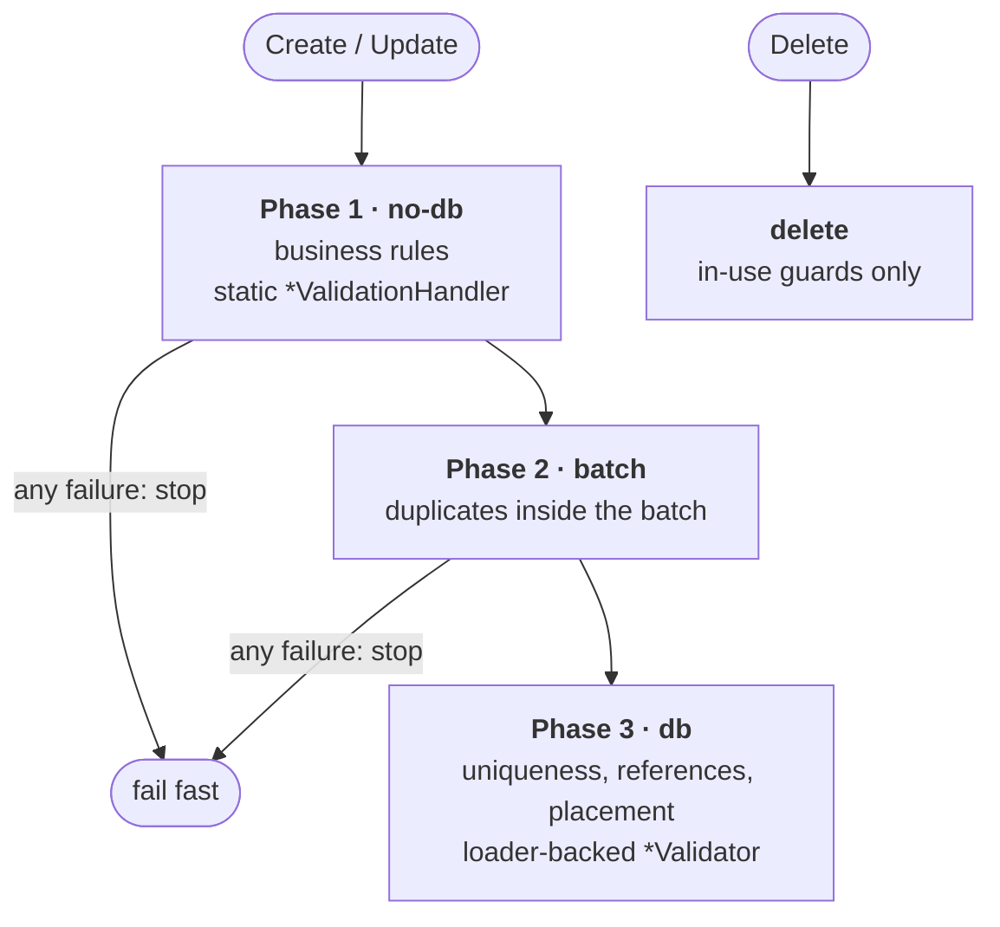
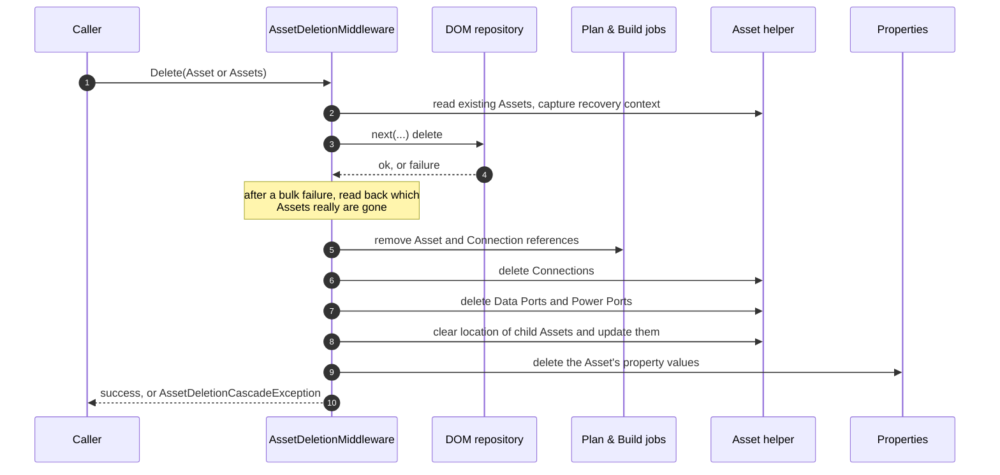

# CAN-003: Repository and middleware pipeline

| Field | Value |
|---|---|
| Owner | Miguel Garrido |
| Created | 2026-11-04 |
| Applies to | Every repository exposed by a domain API helper |
| Supersedes | — |
| Related | [CAN-001](CAN-001-dom-structure.md), [CAN-002](CAN-002-package-architecture.md), [CAN-004](CAN-004-change-tracking.md), [Middleware patterns](../middleware-patterns.md), [ADR-0001](../adr/0001-infraops-package-boundaries-and-composition.md) |

> **Derived from codebase.** Helper constructors, the Core middleware, the domain middleware, `ValidatorBase` and the Asset deletion middleware were read from source. This document names classes and concepts, not file paths. [Middleware patterns](../middleware-patterns.md) holds implementation guidance with code snippets for writing a new middleware; this document is the reference for what exists and what every layer guarantees. Confidence is [Certain] unless a cell says otherwise.

## Table of contents

1. [Layers a call crosses](#1-layers-a-call-crosses)
2. [The DOM repository](#2-the-dom-repository)
3. [Middleware contract](#3-middleware-contract)
4. [Layer order per repository](#4-layer-order-per-repository)
5. [Validation](#5-validation)
6. [Asset deletion cascade](#6-asset-deletion-cascade)
7. [Other domain middleware](#7-other-domain-middleware)
8. [Rules](#8-rules)
9. [Facts reviewers must know](#9-facts-reviewers-must-know)
10. [Rejected alternatives](#10-rejected-alternatives)

## Terms

| Term | Meaning here |
|---|---|
| API helper | The domain object that owns the wrapped repositories ([CAN-002](CAN-002-package-architecture.md)). |
| DOM repository | `<Entity>DomRepository`: translates entities to and from DOM instances and talks to the `DomHelper`. |
| Middleware | An `IBulkRepositoryMiddleware<T>` layer that sees every operation before the next layer. |
| `next` | The delegate that continues to the next layer. It is not a second public call on the repository. |
| Wrapped repository | The DOM repository after all `WithMiddleware` calls; the object consumers use. |
| Validator | An `IValidator<T>`, usually a `ValidatorBase<T>` subtype, that returns one `ValidationResult` per entity. |
| Cascade | Work that touches other entities as a consequence of one operation (Asset delete, Property delete). |

---

## 1. Layers a call crosses

The consumer never sees the raw repository. The helper exposes the wrapped one, typed as `IBulkRepository<T>` or a domain interface that extends it.

## 2. The DOM repository

One class per entity, bound to its module through a `DomHelper`. What every repository provides:

| Operation | Behaviour |
|---|---|
| Create (single) | `ToInstance`, create, `FromInstance` of the stored instance. The returned object is a **new** object with a clean change-tracking baseline ([CAN-004](CAN-004-change-tracking.md#3-lifecycle)). |
| Create (bulk) | Checks which identifiers already exist, in batches of 500, then creates the rest in batches of the DOM maximum bulk size. Reports pre-existing and failed items per identifier. |
| Update, CreateOrUpdate (bulk) | Batched `TryCreateOrUpdate`; failures are reported per item. |
| Delete | Converts to instances and deletes in batches. |
| Read, Count, ReadPaged | Filter or query overloads; filters are translated to DOM filters, and a definition-id filter is always added. |
| Failure shape | Any bulk write that has at least one failure throws `SdmBulkCrudException<T>` carrying the successful and the failed items. Successful items are already persisted. |

The repository classes are checked in and hand-maintained. Their file header says "generated", which is historical; see [CAN-001 §12](CAN-001-dom-structure.md#12-facts-reviewers-must-know). Entities with extra read or transition behaviour add it in partial classes or extension classes (Asset, Asset Class, Data Port, Power Port, and the Asset `TransitionTo` family).

Two read shapes are not plain repositories:

| Type | Behaviour |
|---|---|
| Combined port reader | Reads Data Ports and Power Ports through one interface; read-only. |
| App settings | Exposed as the plain repository, without middleware. See §9. |

## 3. Middleware contract

A repository is wrapped with `.WithMiddleware(m)`. The middleware interface has one method per operation and per shape:

| Operation family | Shapes |
|---|---|
| Create, Update, CreateOrUpdate, Delete | single and bulk |
| Read, Count | by filter and by query |
| ReadPaged | by filter or query, each with and without a page size |

Each method receives the input and a `next` delegate.

| Contract | Detail |
|---|---|
| `next` continues the chain | Calling the public wrapped repository again for the same operation recurses or repeats a cascade. |
| Run before `next` | Validate, allocate identifiers, or fail fast. |
| Run after `next` | Cascade or clean up after the real operation has succeeded. |
| Pass-through | A middleware that does not care about an operation still implements it and calls `next`. A base class provides the pass-through members. |
| Order | Each `WithMiddleware` call wraps everything before it, so the **last** call is the **first** layer a request enters (§4). |
| Configuration | Constructor-supplied and immutable. Shared mutable options are not used. |

Core ships two middleware, both `internal` ([CAN-002 §5](CAN-002-package-architecture.md#5-visibility-boundaries)):

| Middleware | Effect |
|---|---|
| `IdentifierMiddleware<T>` | On create, update and create-or-update, gives every entity with an empty identifier a new GUID. Deletes and reads pass through. |
| `ValidationMiddleware<T>` | Runs the entity's validator before write operations and forwards the action (Create, Update, Delete, CreateOrUpdate). Reads and counts get argument guards, and a paged read must have a page size above zero. |

## 4. Layer order per repository

The order is the same in every helper: identifier first, repository last. The table lists what sits in the slots.

| Repository | Identifier | Domain layer | Validation | Cascade | Notes |
|---|---|---|---|---|---|
| Assets | yes | — | yes | **after** DOM delete (§6) | |
| Asset Classes, Ports (Data, Power), Device Types, Port Types, Connections, Cable Types, Reservations, Histories | yes | — | yes | — | |
| Facility Management: Sites, Facilities, Floors, Rooms, Rows, Zones, Desks, Racks | yes | — | yes | — | |
| Plan & Build Jobs | yes | Job-ID allocation | yes | — | Allocation runs before validation, so validation sees the allocated Job ID. |
| Plan & Build Job Types | yes | — | yes | — | |
| Properties | yes | cascade delete **before** DOM delete (§7) | yes | — | The cascade runs before validation. |
| Property Values | yes | — | yes | — | |
| App settings (each domain that has them), combined port reader | no | — | no | — | Plain repository. |

Execution on return: only the Asset cascade does work after `next`, so a failure there is reported after the DOM delete has already succeeded (§6).

## 5. Validation

Every write goes through `ValidationMiddleware<T>` to one `<Entity>Validator : ValidatorBase<T>`. The field-level rules per entity are listed in [CAN-001](CAN-001-dom-structure.md) §3–§6 (the **Rules** column of each Section table and the **Entity rules** lists); this section holds the mechanism.

Rules run in fixed phases and stop at the first phase that fails:

What the caller sees on failure:

| Operation | Failure |
|---|---|
| Single write | `ValidationException` built from the `ValidationResult`. |
| Bulk write | `BulkValidationException<T>` (an `InfraOpsException`) with one failed item per invalid entity and its result. The message shows at most five entities and three reasons each; the full list is on the exception. |
| Validator called directly | `ValidateAndThrow`, `ValidateBulkAndThrow` (throws `ValidationAggregateException`), or a handler callback. |

Conventions that hold for every module [Certain]:

| # | Convention | Implemented by |
|---|---|---|
| V1 | `*ValidationHandler` is `static` and pure: it takes the entity (plus any already-loaded context) and never touches a repository. `*Validator` owns the entity loader / API and runs phases 2–3. | every `*ValidationHandler` / `*Validator` pair |
| V2 | A field rule runs only when `entity.ShouldValidate(<Field>Field)` is true, i.e. `IsNew \|\| field.Changed`. On update, unchanged fields are **not** re-validated; a stored value that violates a newer rule stays valid until touched. | `ValidationExtensions` |
| V3 | Reference rules run when `ReferenceValidationHelper.ShouldValidateReferences` is true (`IsNew \|\| entity.Changed`). | `ReferenceValidationHelper` |
| V4 | Failures are recorded as `AddFailReason(<Entity>ValidationField.<Field>, message)`; the field enum is the key the UI binds to. Several results are merged with `AddFailuresFrom` / `MergeFrom`. | `ValidationResult` |
| V5 | Numeric bounds use `NumericValidators.ValidateNonNegative / ValidatePositive / ValidateRange` with generated messages (`"The {field} cannot be negative."`, `"The {field} must be between {min} and {max}."`). Optional numerics are skipped when `HasValue` is false. | `NumericValidators` |
| V6 | FK presence uses `ReferenceValidationHelper.AddRequiredReference` (`"{target} is required."`) and existence `AddMissingReference` (`"Referenced {target} '{id}' does not exist."`). | `ReferenceValidationHelper` |
| V7 | Delete is not validated unless the validator overrides `ValidateBulkForDelete`; those overrides are in-use guards only. | `ValidatorBase<T>` |
| V8 | Status transitions are validated separately by the state machine ([CAN-001 §7](CAN-001-dom-structure.md#7-state-machines)), not by `*Validator`. Asset additionally runs `AssetTransitionValidator` for multi-hop paths. | state machine, `AssetTransitionValidator` |
| V9 | Single-entity "is this id free" helpers (`IsRackIdValid(string)`, `IsAssetClassNameValid(string)` …) exist for real-time UI checks; they issue one query per call and are not used by the bulk path. | `*Validator` |

Rules that apply when adding or changing a validated field:

| # | Rule | Enforced by |
|---|---|---|
| F1 | Every entity with a repository has one `<Entity>Validator : ValidatorBase<T>` wired through `<Entity>ValidationMiddleware`; the repository never saves an instance that did not pass it. Pure rules live in a `static <Entity>ValidationHandler`, loader-backed rules in the `Validator` (V1). | middleware pipeline |
| F2 | Phases are fixed and fail fast: business rules → batch conflicts → database. A rule that needs another instance (uniqueness, FK existence, placement) belongs in the db phase, never in the Handler. | `ValidatorBase.ValidateBulk` |
| F3 | Field rules are **changed-only** on update (`ShouldValidate` = `IsNew \|\| Changed`). Adding a stricter rule does not invalidate stored data until the field is next touched; a one-off migration is a separate work-item. | `ValidationExtensions` |
| F4 | A failure is keyed by a `<Entity>ValidationField` enum member. Adding a validated field means adding the enum member first; messages are free text but the enum is the API the UI binds to. | `*ValidationField` enums |
| F5 | Numeric bounds go through `NumericValidators`; FK presence/existence through `ReferenceValidationHelper`. Do not hand-roll `< 0` checks or "does not exist" messages. | core validation helpers |
| F6 | State-gated edits (which fields may change in which status) are Handler rules reading the entity's **original** state, not state-machine transitions. Transition legality stays in the state machines. | `Can*` helpers in Handlers |
| F7 | Delete guards are the only rules in `ValidateBulkForDelete`; they check referencing instances (children, connections, ports, jobs) and nothing else. | validator overrides |

Each validator is also exposed on its helper as a public property, so a UI can validate before it writes.

## 6. Asset deletion cascade

Deleting an Asset has consequences in four places, and the Asset is deleted **before** its dependents are cleaned. The participant that does the cleanup lives in the composition ([CAN-002 §3](CAN-002-package-architecture.md#3-composition-root)).

| Aspect | Behaviour |
|---|---|
| Before the DOM delete | Reads each Asset and captures a recovery context: identifier, name, and, depending on policy, the class name and primary IPv4 address. |
| DOM delete | Runs through `next`. A failure is recorded per Asset as stage "Asset DOM delete". |
| Bulk failure | The middleware reads which Assets are really gone, cleans those up, and reports the others as failed. If this read fails, every Asset is reported as failed in stage "Asset DOM result discovery". |
| Cleanup stages | Plan & Build jobs, Connections, Data Ports, Power Ports, Child Assets, Property Values, in that order. The first failing stage stops cleanup for that Asset. |
| Connection snapshots | Captured before cleanup. The policy chooses between removing the job entry and keeping a snapshot, and between cable tags and "Asset - Port" names as the snapshot text. |
| Result | `AssetDeletionCascadeException` with one `AssetDeletionOutcome` per Asset: success flag, failed stage, inner exception, and for post-delete failures a `RecoveryContext`. The exception is thrown only if something failed. |
| Policy | `AssetDeletionPolicy` is set at construction and never changes. |
| Recovery | `RecoverAssetDeletion(context)` retries the cleanup for an Asset whose DOM delete succeeded. The context policy must match the middleware's, and the Asset must be gone. Recovery by identifier alone is allowed only for the default policy, because other policies need the captured data. Each failed recovery returns a new context for the next attempt. A DOM delete failure has no context, because nothing needs recovering. |
| Transactions | None. DOM, Jobs, Connections, Ports and Property Values are separate writes; the outcome list is the only record of what completed. |

## 7. Other domain middleware

| Domain | Middleware | Runs | Effect |
|---|---|---|---|
| Plan & Build | Job-ID allocation | before validation, on create and on the new subset of create-or-update | Assigns the system-generated `JobID`. |
| Plan & Build | Job validation, Job Type validation | write operations | Validators with an external-reference checker for Jobs. |
| Properties | Cascade delete | **before** `next` on delete | Removes Property Value entries that reference the deleted Property. Constructor flag can turn it off. |
| Properties | Property validation, Property Values validation | write operations | Standard validation. |
| Each domain | `<Entity>ValidationMiddleware` | write operations | Subclass of the Core validation middleware bound to that entity's validator. |

Plan & Build Jobs have one extra path: the Job repository holds the validator itself, so the Plan & Build transition helpers, which call the repository's internal update directly, still validate the field updates they persist.

## 8. Rules

| # | Rule | Enforced by |
|---|---|---|
| M1 | A new entity repository is exposed only through a helper that wraps it with the identifier and validation middleware, in that order of entry: identifier first. App settings are the existing exception (§9). | helper constructors |
| M2 | A middleware continues the chain with `next` and never calls the public wrapped repository for the same operation. | code review |
| M3 | Validation runs before the operation; it never runs after a write. | `ValidationMiddleware<T>` |
| M4 | A cascade that must not run for an invalid request sits **inside** validation (closer to the repository), so validation rejects first. The Property cascade does not follow this (§9). | layer order |
| M5 | Post-operation cleanup reports and rethrows its failures; it never converts incomplete cleanup into success. | Asset cascade |
| M6 | Middleware configuration is passed to the constructor and not changed later. The only exception is the Asset cascade's one-time `Configure` ([CAN-002 §3](CAN-002-package-architecture.md#3-composition-root)). | constructors |
| M7 | Logging and timing wrap outside validation, so they see invalid requests too. | convention |
| M8 | A bulk write returns normally only if every item succeeded; otherwise it throws with the successful and failed items. | repository `Create` and `CreateOrUpdate` |

## 9. Facts reviewers must know

| Fact | Confidence |
|---|---|
| App settings repositories and the combined port reader are not wrapped. App settings get no identifier assignment and no validation through the repository, although each helper constructs an app settings validator and exposes it. | [Certain] |
| The Property cascade deletes Property Values **before** the Property delete runs. If the DOM delete then fails, the values are gone and the Property remains. Unlike the Asset cascade, there is no outcome report. The Asset cascade is the reverse: delete first, clean up after. | [Certain] |
| The Property cascade sits outside validation, so it runs before the Property validator sees the delete. The Property validator currently has no delete guard, so the order has no visible effect today. | [Certain] |
| `AssetDeletionMiddleware` throws on delete until `Configure` has been called. The composition always calls it; building the middleware by hand needs the same call. | [Certain] |
| A bulk Asset delete reports success only after every cleanup stage of every deleted Asset has run. Cleanup stops at the first failing stage for an Asset, so an Asset may be left with Connections but no Ports, depending on the stage. | [Certain] |
| The validators are built with the helper itself or an entity loader, so a validator reads through the helper's own wrapped repositories. A validation read therefore passes through the other repositories' read middleware. | [Likely] |
| [Middleware patterns](../middleware-patterns.md) describes the Asset wiring as `deletion → validation → identifier`. That is the order of the `WithMiddleware` calls, which is the reverse of the entry order described here. Both agree. | [Certain] |

## 10. Rejected alternatives

- **Put validation in the DOM repository.** Repositories would then not be reusable for system writes, such as the cascade, that legitimately bypass user-edit validation. The Plan & Build job cleanup uses a raw repository for this reason.
- **Cascade before the Asset delete.** A failed DOM delete would leave the Asset with its dependents already removed. Post-delete cleanup with a recovery context is recoverable.
- **One transaction across DOM, Jobs and Property Values.** Not available across these stores, per [Middleware patterns](../middleware-patterns.md). The outcome list and recovery context replace it.

---
