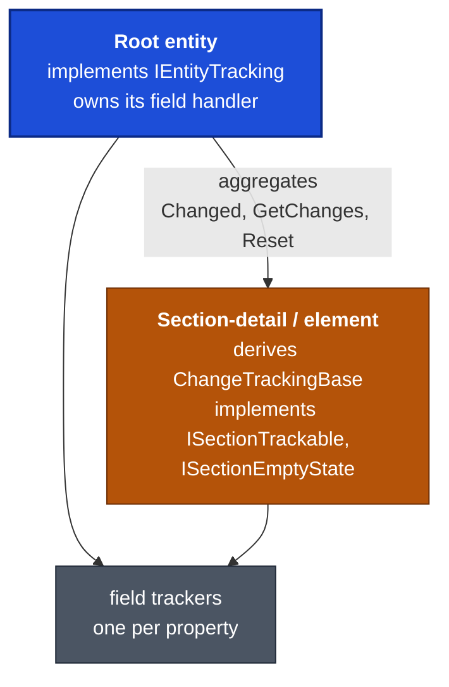
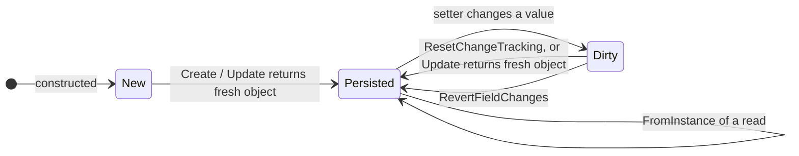
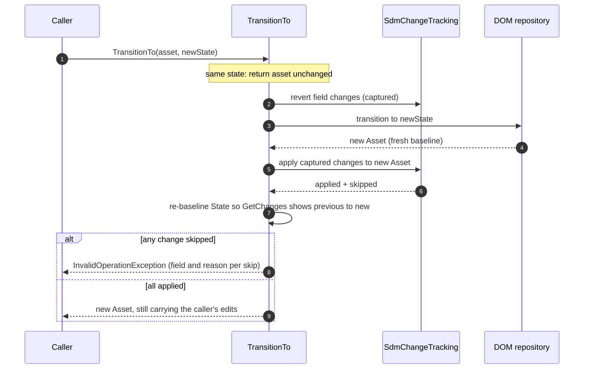

# CAN-004: Change tracking

| Field | Value |
|---|---|
| Owner | Miguel Garrido |
| Created | 2026-11-04 |
| Applies to | Every entity, section-detail and repeating-section element in the four domains |
| Supersedes | — |
| Related | [CAN-001](CAN-001-dom-structure.md), [CAN-002](CAN-002-package-architecture.md), [CAN-003](CAN-003-repository-and-middleware-pipeline.md) |

> **Derived from codebase.** The tracked base types, the field trackers, the field handler, the static change-tracking helper and the Asset transition partial were read from source. This document names types and concepts, not file paths. How a field is *declared* (one property, one tracker; list and section patterns) stays in [CAN-001 §10](CAN-001-dom-structure.md#10-field-rules); this document covers how tracking *behaves*. Confidence is [Certain] unless a cell says otherwise.

## Table of contents

1. [Two kinds of tracked type](#1-two-kinds-of-tracked-type)
2. [Field trackers](#2-field-trackers)
3. [Lifecycle](#3-lifecycle)
4. [Reading, applying and reverting changes](#4-reading-applying-and-reverting-changes)
5. [Asset transitions](#5-asset-transitions)
6. [Rules](#6-rules)
7. [Facts reviewers must know](#7-facts-reviewers-must-know)
8. [Rejected alternatives](#8-rejected-alternatives)

## Terms

| Term | Meaning here |
|---|---|
| Baseline | The values a tracker remembers as "unchanged". `Changed` compares current against baseline. |
| Tracker | A `ChangeTrackingField<T>` or `ChangeTrackingArrayField<T>` that owns the baseline of one property. |
| Field handler | The per-object dictionary of trackers, keyed by property name. |
| Root entity | A top-level entity such as an Asset. Tracks its own fields and aggregates its sections. |
| Section-detail | A single optional or mandatory section object owned by an entity (for example an Asset's Location). |
| Element | One item of a repeating section list (for example an Asset Holder). |
| Section id | The DOM `SectionID` an object was read from. Kept so a write reuses it. |
| Field change | One reported difference: dot-path of the section, field name, old value, new value. |

---

## 1. Two kinds of tracked type

| | Root entity | Section-detail or element |
|---|---|---|
| Base | Does **not** derive from the tracked base class. Implements `IEntityTracking`, which adds `IsNew` to the change-tracking interface. | Derives `ChangeTrackingBase`. |
| `IsNew` | Read-only for callers; set false when read from DOM. | Settable, default true. Not serialised. |
| `Changed` | Its own trackers **or** any section-detail or list that reports a change. The entity must list every section and list explicitly. | Its own trackers only. |
| `GetChanges()` | Own changes plus the changes of each section, prefixed with the section name. | Own changes. |
| `ResetChangeTracking()` | Re-baselines its own trackers, then cascades to sections and to list elements that are tracked. | Re-baselines its own trackers. |
| Section id and empty state | — | `ISectionTrackable` carries the DOM section id. `ISectionEmptyState` says whether every property is at its default. |

The tracked base class and its interfaces are public; the field handler and trackers are `internal` ([CAN-002 §5](CAN-002-package-architecture.md#5-visibility-boundaries)).

## 2. Field trackers

### Single value

| Aspect | Behaviour |
|---|---|
| Supported types | Value types and strings. Any other reference type throws when the tracker is created. |
| State kept | Original value, the original converted for comparison, current value, and an "is set" flag that turns true on any setter call. |
| Reference-struct values | Supplied with a converter that reduces them to their identifier, so a change means "different identifier". |
| Equal when | Both null; or both converted values equal. Strings: null and whitespace are the same as null. |
| Changed when | The original is null and the current is not (or the reverse); for primitives, enums and `Guid` an "is set" flip also counts; otherwise the converted values differ. |
| Reset | Restores the original value and the "is set" flag. |
| Apply | Makes the current value the new baseline. |

### List

| Aspect | Behaviour |
|---|---|
| Behaves as | An `IList<T>` that wraps the property's list. |
| Changed when | The count differs, any element that is itself tracked reports a change, or the converted sequences differ. |
| Apply | Re-baselines the tracked elements, then stores a copy of the list as the baseline. Tracked elements are cloned so later edits do not alter the baseline. |
| Reset | Reverts each tracked element, then restores the baseline list. |
| "Is set" | True when changed or not empty. |

### Field handler

One per tracked object. It creates trackers on first use, keyed by property name, and answers `HasChanges`, `GetChanges`, `ApplyChanges` and `Clone`. Requesting the same key with a different type throws. The key is also the field name reported in a change.

## 3. Lifecycle

| Moment | Effect on tracking |
|---|---|
| Constructed in code | `IsNew` is true; every set field counts as changed. |
| Read from DOM | The mapper marks the entity not new and ends with `ResetChangeTracking()`. A freshly read object has `Changed == false`. |
| Create, Update, transition | The repository returns a **new** object built from the stored instance. Pending edits on the object you passed in are not carried over; keep working with the returned object. |
| Section written | `ToInstance` reuses the section id captured at read time. A new object gets a new id. |
| Section empty | `ToInstance` omits the section and drops a stale entry from the instance. The id stays stable if the section is filled again. |

## 4. Reading, applying and reverting changes

A static helper reads and manipulates changes through reflection, so callers never walk the entity themselves.

| Operation | Visibility | Behaviour |
|---|---|---|
| Get field changes | Public | Walks the entity and its nested sections. Each change carries the dot-path of the section, the field name, the old value and the new value. Skips identity members: identifier, id, `IsNew`, module id. |
| Apply field changes | Internal | Writes each change through the public setters, so the writes are tracked as normal edits. Returns the applied changes and the skipped ones, each skipped one with a reason. |
| Revert field changes | Internal | Restores the original value of every changed field and returns what it reverted. State changes are kept. |

Apply skips a change, with a reason, when:

| Skip reason | Why |
|---|---|
| It is a State change | State changes need a repository transition. |
| It is an identity field | Identity is not editable through this path. |
| The section or field no longer exists on the target | Target has a different shape. |
| The field is read-only | No setter. |
| A null would be written to a non-nullable value type | Cannot represent it. |

Apply converts values between types where it can: enum from string, and explicit or implicit conversions.

Because every change carries its section path, fields with the same name on different sections never collide. Ownership Team and Custody Team are two separate changes.

## 5. Asset transitions

Changing an Asset's State is a repository operation because the state is not a normal field. A transition re-creates the Asset from the stored instance, so pending field edits would be lost. The transition code therefore captures them first and re-applies them afterwards.

| Operation | Order | If the second step fails |
|---|---|---|
| `TransitionTo` | Transition only; pending edits are carried across (diagram above). | — |
| `UpdateAndTransitionTo` | Checks the transition path first, then updates the fields, then transitions. | The field update **stays persisted**; the state is unchanged. |
| `TransitionAndUpdate` | Transitions first, then updates the fields. | The transition **stays persisted**; the field update is not applied. |

After a transition the Asset reports a State change from the previous state to the new one, even though the state is already persisted. The code does this by setting State to the previous value, re-baselining, then setting the new value.

## 6. Rules

| # | Rule | Enforced by |
|---|---|---|
| T1 | `Changed` for a scalar compares converted values. For strings, `null` and whitespace are equal to each other. For primitives, enums and `Guid`, an "is set" flip also counts as a change. | `ChangeTrackingField<T>` |
| T2 | A list tracker is changed when the count differs, any element that is tracked is changed, or the converted sequences differ. It clones tracked elements when it takes a baseline. | `ChangeTrackingArrayField<T>` |
| T3 | `FromInstance` ends with `ResetChangeTracking()`; a freshly read object reports `Changed == false`. | repository |
| T4 | `ResetChangeTracking()` on an entity cascades to every section-detail and to every list element that is tracked. | entity; checked in review and by tests |
| T5 | A root entity's `Changed`, `GetChanges()` and `ResetChangeTracking()` list every section-detail and list explicitly. A new section that is not added there is silently untracked. | entity; checked in review and by tests |
| T6 | Do not keep editing the object you passed to Create, Update or a transition. Use the returned object. | repository contract |
| T7 | Section-detail and element types implement `ISectionTrackable` and `ISectionEmptyState` ([CAN-001 §10](CAN-001-dom-structure.md#10-field-rules), C1 and C2). | convention; tests |
| T8 | Change a State only through a repository transition. Applying a State change through the helper is skipped by design. | `SdmChangeTracking` |
| T9 | A new tracked field is registered under `nameof(Property)`; the name is both the key and the reported field name (CAN-001 B1). | `ChangeTrackingFieldHandler` |

## 7. Facts reviewers must know

| Fact | Confidence |
|---|---|
| Root entities do not derive from the tracked base class. Anything that expects every tracked object to be a `ChangeTrackingBase` will miss root entities. | [Certain] |
| A change report is a diff against the last baseline, not an audit. After `ResetChangeTracking` or a read, earlier edits are gone. | [Certain] |
| A state transition keeps the caller's pending edits, but applies them again through the public setters. A target that rejects an edit (read-only, missing) makes the transition throw **after** the transition has persisted. | [Certain] |
| `UpdateAndTransitionTo` and `TransitionAndUpdate` are two writes, not one. Whichever runs second can fail with the first already persisted. | [Certain] |
| Moving the destination location into the main location when an Asset leaves *In Transit* is **not implemented**. A commented-out block in the transition code sketches it. | [Certain] |
| `Asset` has an `Id` property that nothing reads or writes; the entity identity is `Identifier` ([CAN-001 §13](CAN-001-dom-structure.md#13-known-deviations-flagged-not-fixed)). | [Certain] |
| Tracked-field types: only value types and strings. A new field of another reference type needs a list tracker or a section-detail. | [Certain] |
| Changed-only validation relies on this mechanism: if a setter bypasses the tracker, validation skips the field ([CAN-003 §5](CAN-003-repository-and-middleware-pipeline.md#5-validation), V2). | [Certain] |
| Public change reporting (`GetFieldChanges`) is part of the API; apply and revert are `internal`. Consumers can read changes but cannot replay them. | [Certain] |

## 8. Rejected alternatives

- **A fresh section id on every write.** DOM rejects the write when a field it treats as read-only appears to change, because the section looks different. The captured id avoids that ([CAN-001 §10](CAN-001-dom-structure.md#10-field-rules), C1).
- **Writing empty optional sections.** A section with only defaults would be stored as a real section. Omitting it keeps instances free of placeholders ([CAN-001 §10](CAN-001-dom-structure.md#10-field-rules), C2).
- **Tracking reference types in a single-value tracker.** The tracker refuses them; reference-struct values use a converter and collections use the list tracker, so equality always means value equality.

---
