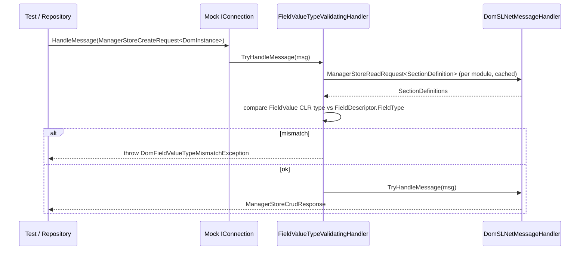

# SPC-001: DOM mock field-value-type validation

| Field | Value |
|---|---|
| Work-item | [ITM-001](../items/ITM-001-dom-mock-field-value-type-validation.md) |
| Status | Implemented (2026-10-29). Deviation: section definitions are read via `DomHelper.SectionDefinitions.ReadAll()` on the inner handler instead of a hand-built `ManagerStoreReadRequest<SectionDefinition>`; same traffic, less code. |
| Created | 2026-10-28 |

## Design

Decorate, don't subclass. `DomSLNetMessageHandler` has no virtual members and does not expose its section-definition store, so the decorator sits in front of `TryHandleMessage` in the test project's `ConnectionHelper` and resolves descriptors by issuing a `ManagerStoreReadRequest<SectionDefinition>` back into the same handler (cached per module).



## Files

| Action | Path |
|---|---|
| Add | `SDM.AssetManagementTests\Setup\FieldValueTypeValidatingMessageHandler.cs` |
| Add | `SDM.AssetManagementTests\Setup\DomFieldValueTypeMismatchException.cs` |
| Edit | `SDM.AssetManagementTests\ConnectionHelper.cs` (wrap the handler) |
| Add | `SDM.AssetManagementTests\Connections\ConnectionDomStorageProvider_FieldTypeTests.cs` |

No changes to `SDM.AssetManagement.Common`, `Directory.Packages.props` or the generated repositories.

## `FieldValueTypeValidatingMessageHandler`

```csharp
internal sealed class FieldValueTypeValidatingMessageHandler
{
    private readonly DomSLNetMessageHandler _inner;
    private readonly ConcurrentDictionary<string, IReadOnlyDictionary<SectionDefinitionID, SectionDefinition>> _cache = new();

    public FieldValueTypeValidatingMessageHandler(DomSLNetMessageHandler inner) => _inner = inner;

    public bool TryHandleMessage(DMSMessage message, out DMSMessage response)
    {
        switch (message)
        {
            case ManagerStoreCreateRequest<DomInstance> r:  Validate(r.ModuleId, r.Object); break;
            case ManagerStoreUpdateRequest<DomInstance> r:  Validate(r.ModuleId, r.Object); break;
            case ManagerStoreBulkCreateOrUpdateRequest<DomInstance> r:
                foreach (var o in r.Objects) Validate(r.ModuleId, o);
                break;
            case ManagerStoreCreateRequest<SectionDefinition> r:  _cache.TryRemove(r.ModuleId, out _); break;
            case ManagerStoreUpdateRequest<SectionDefinition> r:  _cache.TryRemove(r.ModuleId, out _); break;
            case ManagerStoreDeleteRequest<SectionDefinition> r:  _cache.TryRemove(r.ModuleId, out _); break;
        }

        return _inner.TryHandleMessage(message, out response);
    }
}
```

### Validation rules

For each `section` in `instance.Sections`, for each `fieldValue` in `section.FieldValues`:

1. Resolve `SectionDefinition` from cache. **Not found → skip section** (criterion 4).
2. Resolve `FieldDescriptor` via `sectionDefinition.GetFieldDescriptorById(fieldValue.FieldDescriptorID)`. **Not found → skip field.** (Existence is `validateAgainstDefinition`'s job, not this item's.)
3. `actual = fieldValue.Value?.Value`. **`null` → skip** (mirrors server and the `ToInstance` guards; never force `Guid.Empty`).
4. `expected = fieldDescriptor.FieldType`. If `expected == null` → skip.
5. Pass when `expected.IsInstanceOfType(actual)`. Otherwise throw.

Rule 5 deliberately uses assignability, not equality: `List<Guid>` descriptors accept `List<Guid>` instances, and nullable/boxed primitives behave as the server does. Enum fields are declared as `int`/`long` in the seed and written as such by the mappers; no special casing.

### Section-definition lookup

```csharp
private IReadOnlyDictionary<SectionDefinitionID, SectionDefinition> GetSectionDefinitions(string moduleId)
    => _cache.GetOrAdd(moduleId, id =>
    {
        var request = new ManagerStoreReadRequest<SectionDefinition>(id, new TRUEFilterElement<SectionDefinition>().ToQuery());
        var response = (ManagerStoreCrudResponse<SectionDefinition>)_inner.HandleMessage(request);
        return response.Objects.ToDictionary(s => s.GetID(), s => s);
    });
```

`SetSectionDefinitions` is called before any instance traffic in `ConnectionHelper.CreateConnection()`, so cache warm-up is lazy and safe. The `SectionDefinition` CRUD cases above invalidate it for tests that mutate definitions at runtime.

## `DomFieldValueTypeMismatchException`

```csharp
internal sealed class DomFieldValueTypeMismatchException : InvalidOperationException
{
    public DomFieldValueTypeMismatchException(string moduleId, SectionDefinition section, FieldDescriptor field, Type expected, object actual)
        : base($"DomInstanceSectionInvalidFieldValueTypes: module '{moduleId}', section '{section.GetName()}' ({section.GetID().Id}), " +
               $"field '{field.Name}' ({field.ID.Id}) expects '{expected.FullName}' but got '{actual.GetType().FullName}' (value: '{actual}').")
    { }
}
```

The message prefix reuses the server's error name so a grep for it finds both.

## `ConnectionHelper.cs` change

```csharp
internal static IConnection CreateConnection()
{
    var messageHandler = new DomSLNetMessageHandler();
    messageHandler.AddAssetManagementModule();
    messageHandler.AddFacilityManagementModule();
    return CreateConnection(new FieldValueTypeValidatingMessageHandler(messageHandler));
}
```

`CreateConnection(...)`, `HandleSLNetMessages`, `HandleSLNetMessage` and `TryHandleSLNetMessage` change their parameter type from `DomSLNetMessageHandler` to `FieldValueTypeValidatingMessageHandler`. No other test touches the handler type directly (verified by grep: only `ConnectionHelper.cs` references `DomSLNetMessageHandler` in this project).

## Tests: `ConnectionDomStorageProvider_FieldTypeTests.cs`

Builds raw `DomInstance`s to bypass the (already fixed) mapper. Uses `ConnectionHelper.CreateConnection()` and a `DomHelper(connection.HandleMessages, SlcAsset_Management.ModuleId)`.

| Test | Arrange | Assert |
|---|---|---|
| `Create_WithStringInGuidField_ShouldThrowTypeMismatch` | `DomInstance` for `Definitions.Connections`, `SourceInfo.SourcePort = "not-a-guid"` (`ValueWrapper<string>`) | `Throws<DomFieldValueTypeMismatchException>()`, message contains `Source Info`, `Source Port`, `System.Guid`, `System.String` |
| `Create_WithGuidInGuidField_ShouldSucceed` | Same instance, `SourcePort = Guid.NewGuid()` | No throw; instance readable |
| `Update_WithStringInGuidField_ShouldThrowTypeMismatch` | Create valid, then update with `CableInformation.CableType = "x"` | Throws, message names `Cable Information` / `Cable Type` |
| `CreateOrUpdate_Bulk_WithOneBadInstance_ShouldThrowBeforePersisting` | Two instances, second has `string` in `DestinationInfo.DestinationPort` | Throws; `Read` returns 0 instances (validation happens before `_inner` persists either) |
| `Create_WithNullGuidField_ShouldNotThrow` | `SourcePort` field present with `null` value | No throw |
| `Create_InSectionWithoutDefinition_ShouldNotValidate` | Fresh `DomSLNetMessageHandler` with no `SetSectionDefinitions`, string in a `Guid` field | No throw |

Note on the bulk test: `ManagerStoreBulkCreateOrUpdateRequest` is validated in full before delegation, so the whole batch is rejected. The real server returns per-instance `unsuccessfulIds` instead. This is a deliberate simplification; it is stricter than production, which is the right direction for a safety net.

## Verification steps (reported in the item, not committed)

1. `dotnet test SDM.AssetManagementTests --filter "FullyQualifiedName~Connections"` → green.
2. Edit `ConnectionDomRepository.g.cs` line ~659 region: change `AddOrUpdateValue<Guid>(... SourcePort ...)` to `AddOrUpdateValue<string>(..., obj.Source.Port.ToString())`.
3. Re-run step 1 → `Create_WithValidConnection_ShouldPersistAndReadBack` fails with `DomFieldValueTypeMismatchException`.
4. `git checkout -- "SDM.AssetManagement.Common/DOM Repositories/Connection/ConnectionDomRepository.g.cs"`.
5. `dotnet test SDM.AssetManagementTests` (full) → green.
6. `dotnet test` at solution root → confirm other test projects unaffected.

## Risks

- **False positives from existing seed data.** Some seeded `FieldDescriptor` types may not match what current mappers write (e.g. `int` vs `long` enums, `DateTime` vs `DateTimeOffset`). These are real mapper/seed disagreements and must be fixed or flagged, not suppressed. Budget: triage before declaring the item done; if a mismatch is a seed error, fix the seed in `AssetManagementMockMessageHandler.cs` and note it in the item.
- **Facility module shares the handler.** `AddFacilityManagementModule()` registers typed definitions too, so Facility writes made from Asset tests are validated as well. Intended.
- **Performance.** One extra dictionary lookup per field value. Negligible.

## Rejected alternatives

- **Upgrade Utils.DOM to 10.6.1.1 and set `validateAgainstDefinition: true`.** Verified against `main`: no CLR-type check. Would also require auditing every seeded descriptor for `IsOptional`, which is a separate item.
- **Subclass `DomSLNetMessageHandler`.** Nothing is virtual.
- **Put the decorator in `SDM.AssetManagement.Common.Mock`.** Ships test-only policy in the consumer package. Keep it in the test project until a second test project needs it.
