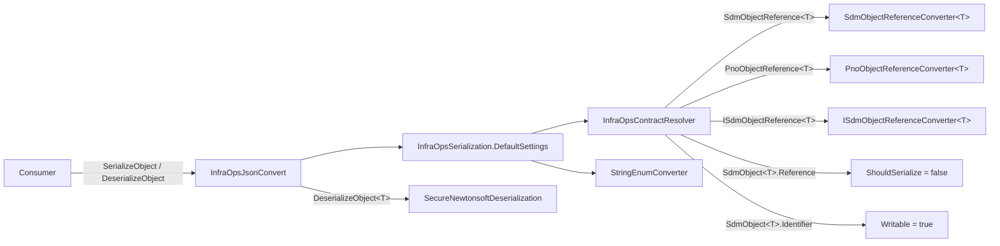

# SPC-002: SDM JSON serialization contract

| Field | Value |
|---|---|
| Work-item | [ITM-002](../items/ITM-002-sdm-json-serialization-contract.md) |
| Status | In review |
| Created | 2026-10-28 |

## Design

One public facade (`InfraOpsJsonConvert`) over `Newtonsoft.Json`, configured by a single `JsonSerializerSettings` instance whose contract resolver swaps in a value converter for each reference struct and adjusts two `SdmObject<T>` members. Secure deserialization comes from `Skyline.DataMiner.Utils.SecureCoding`.



## Files

| Action | Path |
|---|---|
| Add | `SDM.InfraOps.Core\Converters\InfraOpsJsonConvert.cs` |
| Add | `SDM.InfraOps.Core\Converters\PnoObjectReferenceConverter.cs` |
| Add | `SDM.InfraOps.Core\Converters\ISdmObjectReferenceConverter.cs` |
| Edit | `SDM.InfraOps.Core\Converters\InfraOpsContractResolver.cs` (namespace, two new converter branches, `member.Name` match) |
| Edit | `SDM.InfraOps.Core\Converters\SdmObjectReferenceConverter.cs` (namespace only) |
| Edit | `SDM.InfraOps.Core\Converters\InfraOpsSerialization.cs` (namespace only) |
| Edit | `SDM.InfraOps.Core\SDM.InfraOps.Core.csproj` (+ `Skyline.DataMiner.Utils.SecureCoding`) |
| Edit | `Directory.Packages.props` (`SecureCoding` 2.2.1 → 2.2.3) |
| Add | 25 × `<Model>JsonRoundTripTests.cs` across the four domain test projects |

Namespace for all converters: `Skyline.DataMiner.SDM.InfraOps.Core.Converters` (was `SharedCommonLibrary.Converters`).

## Contract rules

| # | Rule | Where enforced |
|---|---|---|
| 1 | `SdmObjectReference<T>`, `PnoObjectReference<T>`, `ISdmObjectReference<T>` serialize as a JSON string holding the identifier. Empty reference → JSON `null` (Pno and Sdm: `Identifier` is null/`Guid.Empty`; the implicit `string` operator on Pno returns `null` for `Guid.Empty`). | Converters `WriteJson` |
| 2 | JSON string or `null` deserializes back through the struct's explicit `string` operator (`Pno`, `ISdm`) or constructor (`Sdm`). `""` and `null` → `default` for Pno/ISdm. | Converters `ReadJson` |
| 3 | `SdmObject<T>.Reference` is never written. | `CreateProperty`, `ShouldSerialize = _ => false` |
| 4 | `SdmObject<T>.Identifier` is written and readable so an import can preserve ids. The setter is already `public` in `Skyline.DataMiner.Dev.Utils.SDM.Abstractions`, so `Writable = true` is defensive against a future non-public setter. | `CreateProperty`, `Writable = true` |
| 5 | Enums (scalar and `List<Enum>`) serialize as names. | `StringEnumConverter` in `DefaultSettings` |
| 6 | Audit fields (`CreatedAt`, `CreatedBy`, `LastModified`, `LastModifiedBy` on `SdmObjectBase<T>` in Core; `State` on each stateful model) have `internal` setters. `DefaultContractResolver` only treats public setters as writable, so they export but are default after import. Tests can set them through `InternalsVisibleTo`. | Model definition (`internal set`); verified by reflection 2026-10-28 and by `*_AuditFields_ExportedButNotImported` |
| 7 | `TypeNameHandling` is `None`; the untyped overload throws `InsecureSerializationSettingsException` if it is ever changed. | `InfraOpsJsonConvert.DeserializeObject(string, Type)` |
| 8 | Deserialization of a typed target goes through `SecureNewtonsoftDeserialization.DeserializeObject<T>`. | `InfraOpsJsonConvert.DeserializeObject<T>` |

## `InfraOpsJsonConvert`

```csharp
public static class InfraOpsJsonConvert
{
    public static T DeserializeObject<T>(string json)
        => SecureNewtonsoftDeserialization.DeserializeObject<T>(json, InfraOpsSerialization.DefaultSettings);

    public static object DeserializeObject(string json, Type type);   // guards TypeNameHandling, then JsonConvert
    public static string SerializeObject<T>(T value)
        => JsonConvert.SerializeObject(value, typeof(T), InfraOpsSerialization.DefaultSettings);
    public static string SerializeObject(object value, Type type);
}
```

`SerializeObject<T>` uses `typeof(T)` as the declared root type. With `TypeNameHandling.None` this only affects which contract is used for the root; callers should pass the concrete model type.

## Converter shape

All three converters are `internal sealed`-style `JsonConverter<TRef>` with the same two-liner body:

```csharp
ReadJson  => (TRef)(string)reader.Value;        // Pno, ISdm: explicit operator; Sdm: new SdmObjectReference<T>(string)
WriteJson => writer.WriteValue(<identifier as string>);
```

Resolution happens in `InfraOpsContractResolver.ResolveContractConverter` by matching the open generic type definition and building the closed converter via `Activator.CreateInstance(typeof(XConverter<>).MakeGenericType(arg))`.

## Tests

Each `<Model>JsonRoundTripTests.cs` follows the same pattern. Representative (Asset):

| Test | Asserts |
|---|---|
| `<Model>_RoundTrip_Preserves…References` | Every reference field equal after round-trip; `restored.Should().Be(original)`; re-serialize is byte-identical |
| `<Model>_AuditFields_ExportedButNotImported` | Audit fields present in JSON, default after deserialize |
| `<Model>_Serialize_WritesReferencesAsStringsAndEnumsAsNames` | `"Field":"<guid>"`, `"Enums":["Name"]` |
| `<Model>_Serialize_EmptyReferencesAreNull` | `"Field":null` for unset references |
| `<Model>_Deserialize_NullAndEmptyReferencesBecomeDefault` | `null` and `""` → `Guid.Empty` / null identifier |

Coverage: 11 Asset Management, 9 Facility Management, 3 Plan and Build, 2 Properties models. 129 tests. Run with:

```
dotnet test <TestProject> --filter "FullyQualifiedName~JsonRoundTrip"
```

Result 2026-10-28: 48 + 39 + 9 + 33* green (*Properties filter also included the PropertyScope generic tests).

## Open review points and proposed resolutions

| # | Finding | Proposed change |
|---|---|---|
| 1 | `DeserializeObject(string, Type)` writes `settings.SerializationBinder = null` on the shared public static `DefaultSettings`. | Make `InfraOpsSerialization` `static`; keep `DefaultSettings` but build it in a static factory `CreateSettings()` and have the facade call the factory, or validate without assigning. |
| 2 | `ArgumentException` for null `json`. | `ArgumentNullException(nameof(json))`. |
| 3 | `SecureCoding` 2.2.3 vs `SecureCoding.Analyzers` 2.2.1. | Bump analyzers to 2.2.3 or document why they differ. |
| 4 | `SdmObjectReferenceConverter.ReadJson` returns a reference with null `Identifier` for JSON `null`; other two return `default`. | Add `if (reader.Value == null) return default;` for symmetry, plus a focused test (`Create_FromJsonNull_ShouldBeDefault`) per converter. |
| 5 | Root-type behaviour of `SerializeObject<T>`. | Document (done above). No code change. |

None of these block the round-trip contract; 1 and 4 are the ones worth fixing before the import/export consumer ships.

## Proposed canonical doc (needs approval)

`/docs/canon/CAN-002-sdm-json-contract.md` (CAN-001 is the DOM structure canon) containing the "Contract rules" table above, so the import/export repository can reference it instead of this spec. Not created; awaiting approval.

## Risks

- **Consumer mutates `DefaultSettings`.** Any assembly can add converters or flip `TypeNameHandling` on the shared instance. Review point 1 closes this.
- **Model adds a public audit setter.** Rule 6 relies on the `internal` setters, not on the resolver. A model that widened `State` to `public set` would silently become importable. The per-model `*_AuditFields_ExportedButNotImported` test catches it.
- **Naming strategy.** If a `NamingStrategy` is ever set on the resolver, rules 3 and 4 still hold because matching is on `member.Name`.

## Rejected alternatives

- **Serialize references as objects.** The structs have no settable members; deserialization would need a custom `JsonConverter` anyway and the JSON would be twice as verbose.
- **`System.Text.Json`.** Core already depends on `Newtonsoft.Json` through SDM and SecureCoding; no second serializer.
- **Keep converters in `SharedCommonLibrary.Converters`.** Wrong assembly namespace; moved to Core so consumers have one import.
