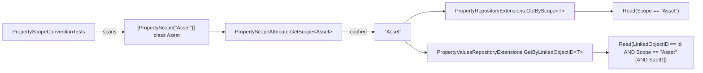

# SPC-003: PropertyScope convention

| Field | Value |
|---|---|
| Work-item | [ITM-003](../items/ITM-003-property-scope-convention.md) |
| Status | In review |
| Created | 2026-10-28 |

## Design

A class-level attribute declares the Properties scope of an SDM model. Generic extension overloads on `IBulkRepository<Property>` and `IBulkRepository<PropertyValues>` read the scope from the type parameter and delegate to the existing string-scope overloads. A packaging test scans the four Common assemblies and enforces "scope == class name, unique".



## Files

| Action | Path |
|---|---|
| Add | `SDM.InfraOps.Core\Models\PropertyScopeAttribute.cs` |
| Edit | 23 model files in `SDM.AssetManagement.Common\Models`, `SDM.FacilityManagement.Common\Models`, `SDM.PlanAndBuild.Common\Models` (+1 line each: `[PropertyScope("<ClassName>")]`) |
| Edit | `SDM.InfraOpsProperties.Common\Extensions\PropertyRepositoryExtensions.cs` (+ `GetByScope<T>`, `GetByScopeAndName<T>`) |
| Edit | `SDM.InfraOpsProperties.Common\Extensions\PropertyValuesRepositoryExtensions.cs` (+ `GetByLinkedObjectID<T>`, `GetSingleOrDefaultByLinkedObjectID<T>`, `CopyPropertyValues<T>`) |
| Add | `SDM.InfraOps.PackagingTests\PropertyScopeConventionTests.cs` |
| Add | `SDM.InfraOpsProperties.Tests\Extensions\PropertyScopeGenericExtensionsTests.cs` |

## `PropertyScopeAttribute`

```csharp
[AttributeUsage(AttributeTargets.Class, AllowMultiple = false, Inherited = false)]
public sealed class PropertyScopeAttribute : Attribute
{
    public PropertyScopeAttribute(string scope);          // ArgumentException on null/empty/whitespace
    public string Scope { get; }
    public static string GetScope<T>();                   // InvalidOperationException if missing
    public static string GetScope(Type type);             // ArgumentNullException on null type
}
```

- Lookup uses `GetCustomAttribute<PropertyScopeAttribute>(inherit: false)`, consistent with `Inherited = false`.
- Results cached in a `ConcurrentDictionary<Type, string>`; attribute metadata is immutable so the cache never invalidates.
- Lives in `SDM.InfraOps.Core.Models` so every Common package can reference it without depending on `SDM.InfraOpsProperties.Common`.

## Convention

| Rule | Enforced by |
|---|---|
| Every concrete, non-abstract class deriving (transitively) from `SdmObjectBase<>` in the four Common assemblies carries `[PropertyScope]`. | `EverySdmModelShouldDeclarePropertyScopeEqualToItsClassName` |
| `Scope == type.Name` (case-sensitive). | same |
| Scopes are unique across all four assemblies (case-insensitive). | `PropertyScopesShouldBeUnique` |
| `Property` and `PropertyValues` are exempt (they are the storage models, not property carriers). | `ExcludedModels` array in the test |

Scanned assemblies: `SDM.InfraOpsProperties.Common`, `SDM.FacilityManagement.Common`, `SDM.AssetManagement.Common`, `SDM.PlanAndBuild.Common`.

## Generic overloads

| Extension | Delegates to | Constraint |
|---|---|---|
| `IBulkRepository<Property>.GetByScope<T>()` | `GetByScope(GetScope<T>())` | `T : SdmObject<T>` |
| `IBulkRepository<Property>.GetByScopeAndName<T>(string name)` | `GetByScopeAndName(GetScope<T>(), name)` | `T : SdmObject<T>` |
| `IBulkRepository<PropertyValues>.GetByLinkedObjectID<T>(T obj, string subId = null)` | `GetByLinkedObjectID(obj.GetIdentifierAsGuid(), GetScope<T>(), subId)` | `T : SdmObject<T>`; `ArgumentNullException` on null obj |
| `IBulkRepository<PropertyValues>.GetSingleOrDefaultByLinkedObjectID<T>(T obj, string subId = null)` | `.GetByLinkedObjectID(obj, subId).SingleOrDefault()` | same |
| `IBulkRepository<PropertyValues>.CopyPropertyValues<T>(T source, T target, string subIdSource = null, string subIdTarget = null)` | `CopyPropertyValues(GetScope<T>(), source.Guid, target.Guid, ...)` | same; `ArgumentNullException` on null source/target |

SubID semantics (unchanged from the string overloads):

| `subId` | Filter |
|---|---|
| `null` (default) | `SubID.Equal(null)` → generated repository emits `KeyExists(SubID) == false`, i.e. only entries with no SubID |
| `"*"` | no SubID clause |
| anything else | `SubID.Equal(subId)` exact match |

## Tests

`PropertyScopeConventionTests` (2): convention + uniqueness over the live assemblies.

`PropertyScopeGenericExtensionsTests` (23) against the in-memory DOM mock, using three local test models: `ScopedAssetTestObject` (`"Asset"`), `ScopedFacilityTestObject` (`"Facility"`), `UnscopedTestObject` (no attribute).

| Group | Covers |
|---|---|
| Attribute | blank scope rejected; `GetScope` returns declared value; missing attribute throws with type name; null type throws |
| `GetByScope<T>` | returns only that scope's Properties; other scope returns its own set; unscoped throws; null repo throws |
| `GetByScopeAndName<T>` | existing name found; name from other scope → null; unscoped throws |
| `GetByLinkedObjectID<T>` | match for scoped object; other-scope type → empty; `null` / `"*"` / exact SubID semantics; unscoped, null object, null repo throw |
| `GetSingleOrDefaultByLinkedObjectID<T>` | match or null |
| `CopyPropertyValues<T>` | creates duplicate for target; unscoped throws; null objects throw |

Run with:

```
dotnet test SDM.InfraOps.PackagingTests --filter "FullyQualifiedName~PropertyScopeConventionTests"
dotnet test SDM.InfraOpsProperties.Tests --filter "FullyQualifiedName~PropertyScopeGenericExtensions"
```

Result 2026-10-28: 2 + 23 green.

## Open review points and proposed resolutions

| # | Finding | Proposed change |
|---|---|---|
| 1 | Scope literals duplicate the class name (`[PropertyScope("Asset")]` on `class Asset`). | Optional: `[PropertyScope(nameof(Asset))]`. Convention test already catches drift; cosmetic. |
| 2 | Exemption list for `Property`/`PropertyValues` is hard-coded in the test. | Optional: `[PropertyScopeExempt]` marker attribute if a third storage-only model ever appears. Not needed today. |
| 3 | Generic overloads constrain `T : SdmObject<T>`; convention test scans `SdmObjectBase<>`. A `SdmObjectBase<>`-only model would carry the attribute but be unusable with the generic overloads. | None today. Note it; revisit if such a model is introduced. |

## Risks

- **Renaming a model.** Scope is persisted in DOM data. Renaming `Asset` to `Device` would make the convention test fail until the literal is updated, and then silently orphan existing PropertyValues with scope `"Asset"`. A rename needs a data migration, not just the attribute change. Worth a canonical note.
- **Case.** Convention compares scope to class name case-sensitively but uniqueness case-insensitively. Stored scopes are compared by the DOM filter as-is; keep PascalCase class names.

## Rejected alternatives

- **Derive scope from `typeof(T).Name` with no attribute.** Zero ceremony, but no way to decouple a stored scope from a C# identifier if a rename ever happens, and no compile-time signal that a type participates in Properties.
- **Put the attribute in `SDM.InfraOpsProperties.Common`.** Would force the three domain Common packages to reference the Properties package; the dependency direction in ADR 0001 goes the other way.
- **Virtual `Scope` property on `SdmObjectBase<>`.** `SdmObjectBase<>` is ours (`SDM.InfraOps.Core`), so this was feasible, but it would put a non-persisted member on every model instance and leak into equality/hash/`GetChanges`. A type-level attribute keeps scope as metadata.
